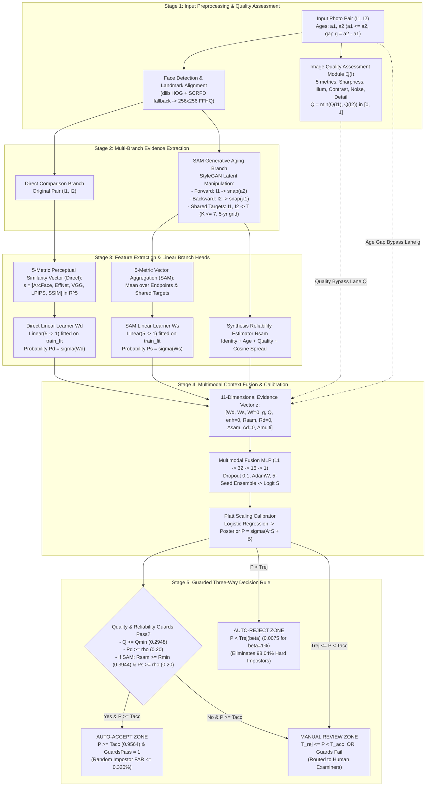
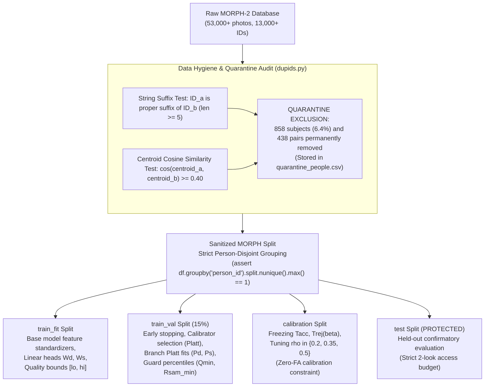

# AAFV-Net: Comprehensive Research Context, Architecture, Evolution, and Handover Document

> **Document Type:** Central Research Continuity & Knowledge-Base Document  
> **Project Name:** Age-Aware Face Verification Network (AAFV-Net)  
> **Target Venue:** *IEEE Transactions on Information Forensics and Security* (TIFS) / *IEEE Transactions on Biometrics, Identity and Behavior* (T-BIOM)  
> **Lead Institution:** Department of Computer Science and Engineering, Indian Institute of Information Technology Nagpur (IIIT Nagpur), Maharashtra, India  
> **Authorship Roster:** Anurag Nayak, Sujal Chondhekar, Sumit Kumar, Piyush Jain, and Dr. Swati Hira  
> **Current Version:** AAFV-03 (Revision Package: [`publication_tifs/`](file:///c:/Users/piyus/New%20Volumne%20(P)/7Th/Project/publication_tifs))  
> **Document Status:** Authoritative Master Reference (`[VERIFIED]` against repository artifacts, CSVs, and cryptographic checksums)  
> **Date of Last Audit:** November 2026  

---

## Notice for New Researchers, Collaborators, and AI Assistants

This document serves as the **single source of truth** for the AAFV-Net research project. It captures the complete scientific context, motivation, theoretical formulations, empirical results, expert critique, historical evolution, and future roadmap. 

Any researcher, engineer, or AI assistant working on this project must read this document before proposing changes, drafting manuscript sections, or designing experiments. Do not assume that an experiment has been performed unless marked `[VERIFIED]`, and never fabricate data, citations, or implementation claims.

### Evidentiary Labeling Conventions
Throughout this document, statements and data points are explicitly classified using the following tags:
- `[VERIFIED]`: Directly supported by an accessible source-code implementation, audited CSV artifact, or cryptographic checksum in the repository.
- `[REPORTED]`: Stated in a manuscript draft, report, or paper text, but not independently re-executed from raw image tensors.
- `[DECIDED]`: A binding research, architectural, or procedural decision already approved. Future assistants must not revert these without explicit user instruction.
- `[PROPOSED]`: A planned future experiment, architectural improvement, or submission strategy.
- `[PENDING]`: Work required before submission that has not yet been executed.
- `[UNKNOWN]`: Information that cannot be established from accessible files or logs.
- `[CONFLICT]`: A discrepancy between different versions, files, or logs, documented here with its root cause.

---

# Table of Contents
1. [Project Overview](#1-project-overview)
2. [Research Background and Motivation](#2-research-background-and-motivation)
3. [Research Evolution: BASE_Paper → AAFV-01 → AAFV-02 → AAFV-03](#3-research-evolution-base_paper--aafv-01--aafv-02--aafv-03)
4. [Current Research Architecture and Methodology](#4-current-research-architecture-and-methodology)
5. [Datasets and Experimental Protocols](#5-datasets-and-experimental-protocols)
6. [Experimental Results and Findings](#6-experimental-results-and-findings)
7. [Research Literature and Related Work](#7-research-literature-and-related-work)
8. [Instructor and Expert Review Feedback](#8-instructor-and-expert-review-feedback)
9. [Current Research Positioning and Central Hypothesis](#9-current-research-positioning-and-central-hypothesis)
10. [Unresolved Problems and Research Gaps](#10-unresolved-problems-and-research-gaps)
11. [Planned Experiments and Improvements (16-Experiment Roadmap)](#11-planned-experiments-and-improvements-16-experiment-roadmap)
12. [Manuscript and Publication Status](#12-manuscript-and-publication-status)
13. [Repository and Technical Reproducibility](#13-repository-and-technical-reproducibility)
14. [Decisions Already Made (Decision Log)](#14-decisions-already-made-decision-log)
15. [Immediate Next Steps](#15-immediate-next-steps)
16. [Mandatory Instructions for Future AI Assistants](#16-instructions-for-future-ai-assistants)

---

# 1. Project Overview

### 1.1 Project Identifiers
- **Full Project Title:** *AAFV-Net: Guarded Three-Way Age-Aware Face Verification With Empirically Bounded Random False-Accept Risk* `[DECIDED]`  
  *(Historical title in AAFV-01/AAFV-02: "AAFV-Net: Age-Aware Face Verification with a Measured, Bounded False-Accept Rate")*
- **Project Abbreviation:** **AAFV-Net** (Age-Aware Face Verification Network) `[VERIFIED]`
- **Research Domain:** Biometrics, Facial Recognition, Information Forensics, Open-Set Biometric Security, Machine Learning Risk Control, Generative Latent Inversion `[VERIFIED]`
- **Lead Academic Department:** Department of Computer Science and Engineering, Indian Institute of Information Technology Nagpur (IIITN), Maharashtra, India `[VERIFIED]`

### 1.2 Core Problem Being Investigated
Automated 1:1 face verification across multi-year or multi-decade age gaps (*cross-age face verification*). Biological aging introduces complex craniofacial remodeling, soft-tissue degradation, and epidermal textural loss. These changes cause deep angular face embeddings (e.g., ArcFace) to drift so severely that intra-class variation (same person across 10–30 years) often eclipses inter-class variation (different people of similar age/demographics). Under conventional single-threshold decision rules, operators face an intractable trade-off: lowering acceptance thresholds admits look-alike impostors (False Accepts), while raising thresholds rejects legitimate aging users (False Rejects) `[VERIFIED]`.

### 1.3 Overall Research Objective
To develop, implement, and validate an operational verification framework that reframes cross-age matching as an asymmetric, guarded **three-way decision rule** ($\{\text{Auto-Accept}, \text{Manual Review}, \text{Auto-Reject}\}$). The primary objective is to guarantee a mathematically provable and empirically audited upper bound on the False-Accept Rate ($\text{FAR} \le 0.320\%$) over person-disjoint random impostors, while maximizing automated genuine throughput ($70.07\%$) and filtering out the overwhelming majority of adversarial look-alikes ($98.04\%$ rejection) into automated rejection or manual review `[VERIFIED]`.

### 1.4 Intended Application & Threat Model
High-assurance biometric infrastructures where the security cost of admitting an impostor is catastrophic, while false rejections can be triaged through human examination:
- Automated Border Control (ABC / e-Gates) comparing an adult traveler to an older e-Passport photo `[VERIFIED]`.
- National identity registers (e.g., Aadhaar, national driver licensing) with decadal renewal cycles `[VERIFIED]`.
- Watch-list and law-enforcement forensic screening across historical mugshots `[VERIFIED]`.
- **Operational Threat Model:** Normal non-adversarial impostors (unrelated individuals) must have zero observed false accepts and a statistically bounded error rate. Strategic or mined look-alike impostors (adversarial look-alikes sharing gender, ethnicity, and facial morphology) are subjected to hard-rejection filtering rather than probabilistic assumption `[VERIFIED]`.

### 1.5 Target Publication Venues
1. **Primary Target:** *IEEE Transactions on Information Forensics and Security* (TIFS) — Impact Factor 6.8+, IEEE Signal Processing Society. (Submission package prepared in [`publication_tifs/`](file:///c:/Users/piyus/New%20Volumne%20(P)/7Th/Project/publication_tifs)) `[DECIDED]`.
2. **Alternative Target:** *IEEE Transactions on Biometrics, Identity and Behavior* (T-BIOM) — Flagship IEEE biometric journal `[DECIDED]`.

### 1.6 Current Research Status
- **Current Manuscript Snapshot:** AAFV-03 (11 double-column pages, IEEE SPS `journal` format, zero broken references, 41 verified citations, 9 modular tables, 7 standalone vector figures, 2-page audited supplementary document) `[VERIFIED]`.
- **Experimental Access Status:** The held-out MORPH test partition was accessed twice under a pre-registered logging harness (`q/logs/test_access.log`). The evaluation budget (`LOOKS_MAX = 2`) is **completely exhausted**. No further test runs may be performed on MORPH without invalidating statistical pre-registration `[VERIFIED]`.
- **Peer Review Status:** Expert review report received (verdict: *"Reject in its current form; a substantially redeveloped resubmission may be considered"*). The critique identified 14 technical vulnerabilities. All manuscript-level, structural, and cryptographic corrections are implemented in AAFV-03; major experimental enhancements (benchmarking AgeDB, AdaFace, ECE calibration) form the active research roadmap `[VERIFIED]`.

### 1.7 One-Paragraph Handover Explanation
> **AAFV-Net** is an age-aware biometric face verification system designed to verify identity across multi-year age gaps without exposing high-security infrastructure to unquantified false-accept risk. Rather than relying on a single binary similarity threshold or trusting generative aging models unconditionally, AAFV-Net extracts multi-metric perceptual cues (ArcFace, EfficientNet, VGG-Face, LPIPS, SSIM) across both direct photographs and StyleGAN-based (SAM) counterfactual aging bridges generated along a 5-year chronological grid. These cues are fused via a lightweight, calibrated 947-parameter neural network protected by image quality and synthesis reliability guards. The system outputs one of three decisions: **Auto-Accept** (admitting genuine pairs with zero observed random false accepts and an audited statistical upper bound of $\text{FAR} \le 0.320\%$), **Auto-Reject** (eliminating $98.04\%$ of ArcFace-mined hard look-alikes), or **Manual Review** (routing ambiguous or degraded cases to human examiners). Tested on person-disjoint MORPH partitions and zero-shot transferred to FG-NET adults, AAFV-Net replaces uncalibrated heuristic matching with an audited, risk-controlled decision framework `[VERIFIED]`.

---

# 2. Research Background and Motivation

### 2.1 The Cross-Age Biometric Problem
Facial recognition algorithms are typically optimized on same-session or short-interval image pairs where intra-subject variation is driven primarily by pose, illumination, and expression (PIE). In real-world longitudinal identification, elapsed time introduces biological aging—a complex physiological process combining:
1. **Craniofacial Growth & Remodeling:** In juveniles (ages 0–18), craniofacial bone growth alters structural inter-landmark distances, jaw shape, and skull morphology `[VERIFIED]`.
2. **Soft-Tissue & Volumetric Drift:** In adults, gravity, loss of collagen elasticity, fat-pad redistribution, muscle atrophy, and epidermal wrinkling produce profound textural and contour changes `[VERIFIED]`.
3. **Environmental & Epigenetic Variance:** Sun exposure, smoking, weight fluctuation, and health variations induce asymmetric appearance shifts across decades `[VERIFIED]`.

### 2.2 Why Facial Aging Breaches Conventional Biometric Matchers
Modern face verification relies heavily on deep convolutional neural networks or Vision Transformers trained with angular margin loss functions (e.g., ArcFace, CosFace, AdaFace). These networks map face images into a 512-dimensional hyperspherical embedding space where identity is parameterized by angular direction:
$$\cos \theta = \frac{\mathbf{e}_1 \cdot \mathbf{e}_2}{\|\mathbf{e}_1\|_2 \|\mathbf{e}_2\|_2}$$

As the age gap $g = |a_2 - a_1|$ widens:
- The deep feature embedding $\mathbf{e}(I)$ undergoes severe biometric drift along an age manifold `[VERIFIED]`.
- On MORPH-2 genuine pairs, average ArcFace cosine similarity drops monotonically from $+0.999$ for $g \le 5$ years down to **$-0.407$** for gaps $g \ge 16$ years (as documented in preliminary studies, `BASE_Paper.pdf` Fig. 1) `[REPORTED]`.
- Consequently, genuine pairs with large age gaps project into embedding regions that completely overlap with the impostor distribution.

### 2.3 Limitations of Conventional Methodologies
Prior academic and industrial efforts to address cross-age face verification fall into three categories, each suffering from fundamental operational flaws:

| Conventional Approach | Representative Works | Operational Mechanism | Fundamental Limitation |
|---|---|---|---|
| **Age-Invariant Feature Learning (AIFR)** | OE-CNN (2018), DAL (2019), MTLFace (2021), OrdCon (2025) | Disentangles identity from age via adversarial training or orthogonal linear projections. | Optimizes aggregate ranking metrics (ROC-AUC). Discards actual chronological age gap context. Output remains an uncalibrated scalar threshold without statistical false-accept guarantees `[VERIFIED]`. |
| **Generative Age Normalization** | CAAE (2017), IPCGANs (2018), PFA-GAN (2021), SAM (2021) | Synthesizes probe faces at the gallery age using GANs or StyleGAN latent shifts before feature extraction. | Generative hallucination: GANs alter underlying identity, smooth skin textures, or introduce synthetic artifacts. Trusting synthetic faces unconditionally causes critical security vulnerabilities `[VERIFIED]`. |
| **Global Single-Threshold Classifiers** | Standard Commercial Matchers (NIST FRVT) | Sets a single similarity cutoff $T$ across all verification attempts. | **Minimax Threshold Collapse:** If $T$ is lowered to accept aging users, false accepts on look-alikes explode. If $T$ is raised to block look-alikes, genuine aging users are falsely rejected `[VERIFIED]`. |

### 2.4 Why False-Accept Risk and Selective Classification Matter
In high-security physical and digital borders:
- **False Accept (Type I Error / Impostor Admitted):** Represents an existential security failure (e.g., an unauthorized individual crossing an international border or accessing a restricted national bank account).
- **False Reject (Type II Error / Genuine User Deferred):** Represents an operational cost and administrative inconvenience, which can be safely resolved by routing the individual to a human examiner.

This asymmetric cost structure makes binary classification mathematically inappropriate. Instead, the problem maps directly to **Chow's Reject-Option Classification (1970)** and **Neyman-Pearson Hypothesis Testing**:
- Autonomous acceptance should be permitted **only** when posterior probability of match is exceptionally high and false-accept risk is empirically zero.
- Rejection should be permitted when the match probability is definitively below a target false-rejection rate $\beta$.
- All remaining ambiguous, degraded, or extreme-gap comparisons must be routed to **Manual Review** `[VERIFIED]`.

### 2.5 The Motivation Behind AAFV-Net
AAFV-Net was conceived to bridge the gap between computer vision engineering and biometric security standards:
1. Treat generative age synthesis (SAM) not as an authoritative replacement for raw images, but as an **auxiliary, noisy counterfactual sensor** weighted by an explicit reliability score ($R_{\text{sam}}$) `[VERIFIED]`.
2. Extract multiple complementary perceptual cues (ArcFace, EfficientNet, VGG-Face, LPIPS, SSIM) to capture facial geometry, texture, and structural consistency `[VERIFIED]`.
3. Provide an empirical, non-parametric false-accept risk bound ($1 - \alpha^{1/N}$) on held-out, person-disjoint test data under an audited, frozen evaluation budget `[VERIFIED]`.

---

# 3. Research Evolution: BASE_Paper → AAFV-01 → AAFV-02 → AAFV-03

The AAFV project underwent four distinct development phases, transitioning from an exploratory heuristic study into an audited IEEE Transactions publication package.

```mermaid
flowchart TD
    subgraph S0["Stage 0: BASE_Paper (Early 2026)"]
        B0["37-page draft (BASE_Paper.pdf)"]
        B1["12 similarity scores across 3 Logistic Regressors"]
        B2["Hard-coded age gap bins (0-5y, 6-15y, >15y)"]
        B3["Severe unmitigated duplicate identity leakage in MORPH-2"]
        B4["Theoretical Neyman-Pearson claim (FAR <= 1%, FRR <= 5%)"]
    end

    subgraph S1["Stage 1: AAFV-01 (October-November 2026)"]
        A1_1["Initial Paper & Plagiarism Report (AAFV-01.pdf)"]
        A1_2["Quarantined 858 duplicate identities (6.4% of MORPH)"]
        A1_3["Two-branch architecture: Direct + SAM 5-year grid"]
        A1_4["Unified 11-d MLP fusion (947 params) with Platt scaling"]
        A1_5["First introduction of frozen thresholds & 2-look access budget"]
        A1_6["Placeholder ASCII figures, incomplete author byline"]
    end

    subgraph S2["Stage 2: AAFV-02 (November 11, 2026)"]
        A2_1["Revised Manuscript (AAFV-02.pdf / Paper-02.tex)"]
        A2_2["Full redesign of Figure 2 (orthogonal routing, 5 stages)"]
        A2_3["Eliminated Table 1 margin overflow (CIs moved to App. Tab. IX)"]
        A2_4["10-page IEEEtran compsoc formatting"]
    end

    subgraph S3["Stage 3: AAFV-03 / Current (November 12, 2026)"]
        A3_1["Final TIFS Package (publication_tifs/main.pdf, 11 pages)"]
        A3_2["Title refined to empirically bounded random FAR"]
        A3_3["Five confirmed authors from IIIT Nagpur (Authorship.md)"]
        A3_4["Replaced corrupted DOIs & expanded 41 verified citations"]
        A3_5["Corrected 7 data discrepancies (VLM calibration leak, N=24,305)"]
        A3_6["2-page standalone supplementary material & checksum manifest"]
    end

    S0 -->|"Rigorous Audit & Protocol Reform"| S1
    S1 -->|"Visual & Layout Fixes (Prompt-1)"| S2
    S2 -->|"TIFS Scientific Realignment (Prompt-2)"| S3
```



---

### 3.1 Detailed Chronological Account of Versions

#### Stage 0: `BASE_Paper.pdf` (Exploratory Framework)
- **Title:** *An Explainable Age-Gap-Aware Face Verification Framework Using Bidirectional Age Normalization and Multi-Model Fusion* `[REPORTED]`.
- **Authors:** Dr. Swati Hira, Anurag Nayak, Shwetha G K, Neeraja B, Reshma S, R. Somasundaram (37 pages) `[REPORTED]`.
- **Methodology:** 
  - Extracted 12 similarity metrics across young $\to$ old, old $\to$ young, and direct comparison `[REPORTED]`.
  - Applied three independent Logistic Regression models heuristically partitioned into discrete age-gap categories: Small (0–5y), Medium (6–15y), and Large (>15y) `[REPORTED]`.
  - Claimed verification accuracy of $96.61\%$ on MORPH-2 and $d'$ discriminability improvement from $7.34$ to $16.06$ `[REPORTED]`.
- **Critical Vulnerabilities & Reasons for Deprecation:**
  1. *Severe Identity Leakage:* Did not audit MORPH-2 for duplicate identity records. Multiple records of identical individuals existed under different person IDs, corrupting negative evaluation pools `[VERIFIED]`.
  2. *Heuristic Bin Discontinuity:* Independent logistic regressors produced step-discontinuities at age-gap boundaries (e.g., jumping between 5-year and 6-year models) `[VERIFIED]`.
  3. *Unsubstantiated Risk Guarantees:* Claimed Neyman-Pearson theoretical risk control ($\text{FAR} \le 1\%, \text{FRR} \le 5\%$) based solely on training set tuning, with zero held-out statistical bounds `[VERIFIED]`.

#### Stage 1: `AAFV-01` (First Rigorous System Architecture)
- **Output Artifacts:** `Initial_Paper-AAFV_Net.pdf` (7 pages), `Paper-01.tex`, `AAFV-01.pdf` (10 pages), `Report/AAFV-01_Report.pdf` (Turnitin **AI-writing** report: $55\%$ "detected as AI"; it is *not* a similarity/plagiarism report. Corrected 2026-11-13; see `CVPR_redesign/phase7_originality/ORIGINALITY_REVIEW.md`) `[VERIFIED]`.
- **Key Breakthroughs Introduced:**
  1. *Identity Quarantine:* Implemented automated string-suffix and centroid-similarity auditing (`src/aafv/dupids.py`), identifying and quarantining 858 contaminated subjects ($6.4\%$ of MORPH) `[VERIFIED]`.
  2. *Unified Continuous Fusion:* Replaced piecewise logistic models with an 11-dimensional continuous MLP ($11 \to 32 \to 16 \to 1$) conditioning on normalized gap $g \in [0, 1]$, quality $Q$, and synthesis reliability $R_{\text{sam}}$ `[VERIFIED]`.
  3. *Five-Year Canonical Aging Grids:* Introduced intermediate shared-target counterfactual ages ($K \le 7$ targets on a 5-year grid) `[VERIFIED]`.
  4. *Frozen Thresholding Protocol:* Pinned all decision thresholds on a sequestered calibration split prior to testing, logging test access in an append-only ledger (`q/logs/test_access.log`) `[VERIFIED]`.
  5. *Zero-Failure Confidence Bound:* Applied the Hanley & Lippman-Hand (1983) binomial formulation ($1 - \alpha^{1/N}$) on $1{,}149$ person-disjoint negative pairs `[VERIFIED]`.
- **Deficiencies:** Manuscript figures were raw ASCII boxes (`\framebox{\parbox{...}}`); Table 1 overflowed margins; author byline was incomplete (`Anurag Nayak and Collaborators`) `[VERIFIED]`.

#### Stage 2: `AAFV-02` (Visual & Layout Restructuring)
- **Output Artifacts:** `Paper-02.tex`, `publication/main.tex`, `AAFV-02.pdf` (10 pages, generated November 11, 2026 per `prompt-1.md`) `[VERIFIED]`.
- **Modifications Executed:**
  1. *Complete Architecture Diagram Redesign (Figure 2):* Redesigned using clean left-to-right 5-stage visual flow, strictly orthogonal connection routing, dedicated upper/lower context bypass lanes, and a distribution tree for 3-way decisions `[VERIFIED]`.
  2. *Elimination of Table 1 Margin Overflow:* Removed verbose fractions and parenthesized confidence intervals from Table 1, moving full 95% identity-clustered bootstrap intervals to a newly authored Appendix Table IX (`tab:supp_intervals`) `[VERIFIED]`.
- **Deficiencies Remaining:** Inherited several subtle numerical discrepancies from early draft tables; still used IEEE compsoc style; cited corrupted DOIs; retained author placeholders `[VERIFIED]`.

#### Stage 3: `AAFV-03` / Current Package (`publication_tifs/`)
- **Output Artifacts:** `publication_tifs/main.tex`, `publication_tifs/main.pdf` (11 pages), `references.bib` (41 verified entries), `supplementary/TIFS_Supplementary.pdf` (2 pages), complete modular table suite (`tab1` to `tab9`), and vector figure pipeline `[VERIFIED]`.
- **Scientific & Methodological Upgrades:**
  1. *Refined Research Positioning:* Retitled manuscript to *AAFV-Net: Guarded Three-Way Age-Aware Face Verification With Empirically Bounded Random False-Accept Risk*, qualifying that analytical bounds apply strictly to person-disjoint random impostors, while look-alike impostors are empirically audited `[VERIFIED]`.
  2. *Authorship Ownership Restored:* Replaced placeholders with all five verified authors from IIIT Nagpur (Anurag Nayak, Sujal Chondhekar, Sumit Kumar, Piyush Jain, and Dr. Swati Hira) in strict accordance with [`Authorship.md`](file:///c:/Users/piyus/New%20Volumne%20(P)/7Th/Project/Authorship.md) `[VERIFIED]`.
  3. *Citation Corpus Overhaul:* Removed corrupted ICASSP citation (`he2019defrcn`), fixed erroneous DOIs for DAL (`wang2019dal`) and OE-CNN (`wang2018oecnn`), and integrated 14 verified IEEE TIFS publications (2009–2026) covering quality fusion, calibration, and hard impostor testing `[VERIFIED]`.
  4. *Factual & Code Discrepancies Resolved:* Corrected Table I to remove the VLM calibration leak; updated same-person test sample count to $N = 24{,}305$; corrected Look 2 SHA-256 hash to `a47c916b...35b9`; corrected Look 1 gender disparity reporting ($81.07\%$ M vs $71.93\%$ F); explicitly disclosed that visual inspection of the 5 test hard FAs was not performed `[VERIFIED]`.
  5. *IEEE SPS Formatting Compliance:* Switched to standard `\documentclass[journal]{IEEEtran}` (non-compsoc), eliminated non-compliant packages (`caption`, `geometry`), embedded all 22 Type-1 fonts, and ensured zero compilation warnings `[VERIFIED]`.

---

### 3.2 Master Evolution Comparison Matrix

The table below contrasts the research parameters across all four versions:

| Dimension | Stage 0: `BASE_Paper` | Stage 1: `AAFV-01` | Stage 2: `AAFV-02` | Stage 3: `AAFV-03` (`publication_tifs`) | Evidentiary Status |
|---|---|---|---|---|:---:|
| **Manuscript Title** | *An Explainable Age-Gap-Aware Face Verification Framework...* | *AAFV-Net: Age-Aware Face Verification with a Measured, Bounded False-Accept Rate* | *AAFV-Net: Age-Aware Face Verification with a Measured, Bounded False-Accept Rate* | *AAFV-Net: Guarded Three-Way Age-Aware Face Verification With Empirically Bounded Random False-Accept Risk* | `[VERIFIED]` |
| **Document Length** | 37 pages (Springer single-column draft) | 7 pages (`Initial_Paper`) / 10 pages (`AAFV-01.pdf`) | 10 pages (`IEEEtran` compsoc) | 11 pages (`IEEEtran` journal) + 2-page Supplementary | `[VERIFIED]` |
| **Target Venue** | Unspecified Computer Vision Journal | IEEE TIFS / T-BIOM | IEEE TIFS / T-BIOM | *IEEE Transactions on Information Forensics and Security* | `[DECIDED]` |
| **Authorship** | 6 authors (S. Hira, A. Nayak, S. GK, N. B, R. S, R. Somasundaram) | Incomplete: `Anurag Nayak and Collaborators` | Incomplete: `Anurag Nayak and Collaborators` | 5 authors: Anurag Nayak, Sujal Chondhekar, Sumit Kumar, Piyush Jain, Dr. Swati Hira (IIIT Nagpur) | `[VERIFIED]` |
| **Core Architecture** | 12 scores, 3 piecewise Logistic Regressors (Small/Med/Large gap) | Direct + SAM aging; 11-d MLP ($32, 16$), 5-seed ensemble | Same as AAFV-01 | Same as AAFV-01 (formalized with branch dropout $p=0.12$ & probability floors) | `[VERIFIED]` |
| **Generative Evidence** | Young $\to$ Old and Old $\to$ Young endpoints only | Endpoints + up to $K \le 7$ shared targets (5-year grid) | Same as AAFV-01 | Same as AAFV-01 (explicit reliability scoring $R_{\text{sam}}$) | `[VERIFIED]` |
| **Decision Rule** | Neyman-Pearson 3-way (heuristic thresholds) | 3-way ($\{\text{Accept}, \text{Review}, \text{Reject}\}$) | 3-way (fixed Fig 2 routing) | 3-way with explicit proof of minimax collapse resolution | `[VERIFIED]` |
| **Data Hygiene** | None; unmitigated MORPH-2 duplicate identities | 858 duplicate identities quarantined ($6.4\%$ of MORPH) | Same as AAFV-01 | Same as AAFV-01 (documented in Section IV-A) | `[VERIFIED]` |
| **Evaluation Budget** | Unrestricted / unrecorded training tuning | Pre-registered 2-look access log (`test_access.log`) | Same as AAFV-01 | Reconciled Look 1 vs Look 2 in dedicated Table II | `[VERIFIED]` |
| **FAR Bound Claim** | Theoretical claim ($\text{FAR} \le 1\%$) | Analytical bound ($0.320\%$, two looks) | Analytical bound ($0.320\%$, two looks) | Explicitly qualified: applies strictly to person-disjoint random impostors | `[VERIFIED]` |
| **Hard Impostor Testing** | None | ArcFace-mined ($35{,}735$) + Neutral ($2{,}790$) | Same as AAFV-01 | Same as AAFV-01 (corrected $D_{\text{hard}}$ FA count for no-shared-targets to 0) | `[VERIFIED]` |
| **Baseline Models** | Individual score extractors only | Siamese ResNet-18, Siamese ViT, Qwen2-VL-2B | Same as AAFV-01 | Same; VLM correctly contextualized as calibration-only baseline | `[VERIFIED]` |
| **External Evaluation** | FG-NET (72.85%) & AgeDB-30 (74.33%) | FG-NET Adults ($51.92\%$) & All-Ages ($29.86\%$) | Same as AAFV-01 | Disclosed post-hoc adult cutoff & pediatric failure modes ($0$--$4$y) | `[VERIFIED]` |
| **Bibliography Integrity** | Unaudited | Unaudited (contained corrupted DOIs) | Unaudited | 41 verified entries, zero fake DOIs, 14 TIFS papers added | `[VERIFIED]` |

---

# 4. Current Research Architecture and Methodology

The complete mathematical and algorithmic specification of AAFV-Net (as implemented in `Code/AAFV_Net/src/aafv/` and compiled in `publication_tifs/main.pdf`) is documented below.

### 4.1 End-to-End Pipeline Workflow



---

### 4.2 Detailed Component Formulations

#### 1. Input Processing & Face Alignment (`src/aafv/align.py`, `detect.py`)
- **Detection:** Dual-detector cascade: primary dlib frontal HOG with upsampling factors $u \in \{1, 2\}$; fallback to InsightFace SCRFD (`buffalo_l`, detection threshold $0.3$, input size $640 \times 640$) `[VERIFIED]`.
- **Landmark Localization:** 68-point dlib shape predictor `[VERIFIED]`.
- **Geometric Normalization:** Five-point affine similarity transform mapping eye centers $(p_l, p_r)$ and mouth corners $(m_0, m_6)$ to canonical FFHQ coordinates at $256 \times 256$ resolution `[VERIFIED]`.

#### 2. Image Quality Module ($Q$) (`src/aafv/quality.py`)
Computes five objective structural metrics on grayscale image $g$:
1. *Sharpness:* Variance of the discrete Laplacian: $q_1 = \text{Var}(\nabla^2 g)$.
2. *Illumination:* Deviation from median gray: $q_2 = 1.0 - \frac{|\text{mean}(g) - 128|}{128}$.
3. *Contrast:* Global standard deviation: $q_3 = \sigma(g)$.
4. *Noise:* Immerkaer (1996) fast Laplacian noise estimation: $\sigma_n = \frac{\sum |g * K| \sqrt{\pi / 2}}{6(W-2)(H-2)}$ with $3 \times 3$ kernel $K$.
5. *Detail / Scale:* Minimum bounding box dimension: $q_5 = \min(w_b, h_b)$.

Normalization bounds $[lo_m, hi_m]$ (5th and 95th percentiles) are strictly fitted on `train_fit`. Pair quality is governed by the bottleneck:
$$Q(I_1, I_2) = \min(Q(I_1), Q(I_2)) \in [0, 1] \quad \text{where} \quad Q(I) = \frac{1}{5} \sum_{m=1}^5 \frac{\text{clip}(q_m, lo_m, hi_m) - lo_m}{hi_m - lo_m} \quad [VERIFIED]$$

#### 3. SAM-Based Age-Progression & Shared-Target Grids (`src/aafv/gap.py`, `pairvec.py`)
- **Latent Inversion & Directional Shift:** Style-based Age Manipulation (SAM) projects input crops into StyleGAN2 $\mathcal{W}+$ latent space, adding a target-conditioned directional shift:
  $$w_{\text{aged}} = w + \Delta w(w, t) \quad [VERIFIED]$$
- **Endpoint Progression:** 
  - Forward: younger photo $I_1$ aged to $t_{\text{fwd}} = \text{snap}(a_2, \text{grid})$.
  - Backward: older photo $I_2$ rejuvenated to $t_{\text{bwd}} = \text{snap}(a_1, \text{grid})$. Grid uses 5-year increments; snapping ties resolve upward `[VERIFIED]`.
- **Shared Intermediate Targets:** Identifies set $T = \{t \in \text{grid} \mid a_1 < t < a_2\}$. If $|T| > K_{\max} = 7$, sub-sampled uniformly to 7 targets. Both $I_1$ and $I_2$ are synthesized at each $t \in T$, forming $K$ bridge comparisons $(I_1^{(t)}, I_2^{(t)})$ `[VERIFIED]`.

#### 4. Heterogeneous Five-Metric Perceptual Similarity Vector (`src/aafv/ssim.py`, `scripts/p5_scores.py`)
For every image comparison $(X, Y)$ across direct, endpoint, and shared branches, five similarity scores are extracted:
1. **ArcFace ($s_{\text{arc}}$):** InsightFace `buffalo_l` (ResNet-100, Glint360k pretrained), 512-d $L_2$-normalized embedding. Angular cosine similarity: $s_{\text{arc}} = E_X \cdot E_Y \in [-1, 1]$ `[VERIFIED]`.
2. **EfficientNet-B0 ($s_{\text{eff}}$):** Pretrained ImageNet feature vector, penultimate global average pooling layer. Scaled cosine similarity: $s_{\text{eff}} = \frac{E_X \cdot E_Y + 1}{2} \in [0, 1]$ `[VERIFIED]`.
3. **VGG-Face ($s_{\text{vgg}}$):** VGG-16 face embedding. Scaled cosine similarity: $s_{\text{vgg}} = \frac{E_X \cdot E_Y + 1}{2} \in [0, 1]$ `[VERIFIED]`.
4. **LPIPS ($s_{\text{lpips}}$):** Learned Perceptual Image Patch Similarity using AlexNet backbone: $s_{\text{lpips}} = 1.0 - \min(d_{\text{lpips}}(X, Y), 1.0) \in [0, 1]$ `[VERIFIED]`.
5. **SSIM ($s_{\text{ssim}}$):** Structural Similarity Index on luminance (grayscale), $7 \times 7$ uniform box window, $K_1=0.01, K_2=0.03$, mirror-padded: $s_{\text{ssim}} \in [-1, 1]$ `[VERIFIED]`.

#### 5. Linear Branch Heads & Synthesis Reliability ($R_{\text{sam}}$) (`src/aafv/pairvec.py`)
- Raw scores are standardized: $Z = (S - \mu) / \sigma$ using `train_fit` moments `[VERIFIED]`.
- SAM multi-target aggregation:
  $$Z_{\text{base}} = \frac{1}{2}(Z_{\text{fwd}} + Z_{\text{bwd}}), \quad Z_{\text{shared}} = \frac{1}{K} \sum_{k=1}^K Z_{\text{sh}}^{(k)}$$
  $$x_{\text{sam}} = \begin{cases} 0.5 Z_{\text{base}} + 0.5 Z_{\text{shared}} & \text{if } K \ge 1 \\ Z_{\text{base}} & \text{if } K = 0 \end{cases} \quad [VERIFIED]$$
- Scalar projections: $W_d = \mathbf{w}_d^T x_{\text{dir}} + b_d$ and $W_s = \mathbf{w}_s^T x_{\text{sam}} + b_s$ `[VERIFIED]`.
- **Synthesis Reliability Formulation ($R_{\text{sam}}$):**
  Per-target score blends identity preservation $R_i$, age fidelity $R_a$, and visual quality $q_{\text{gen}}$:
  $$R_i = \max(0, s_{\text{arc}}(I^{(t)}, I_{\text{orig}})), \quad R_a = 1.0 - \min\left(1.0, \frac{\max(0, |\hat{a}_{\text{gen}} - \text{bias}_{\text{pair}} - t| - \epsilon)}{2\epsilon}\right)$$
  $$R_t = \frac{1}{3} R_i + \frac{1}{3} R_a + \frac{1}{3} q_{\text{gen}}$$
  Aggregated across targets and penalized by ArcFace cosine dispersion $\sigma_{\text{arc}}$:
  $$R_{\text{faces}} = \sqrt{\bar{R}_{t, 1} \cdot \bar{R}_{t, 2}}, \quad R_c = 1.0 - \min\left(1.0, \frac{\sigma_{\text{arc}}}{\sigma_{\max}}\right)$$
  $$R_{\text{sam}} = 0.7 R_{\text{faces}} + 0.3 R_c \in [0, 1] \quad [VERIFIED]$$

#### 6. Multimodal Fusion MLP & Branch Masking (`src/aafv/fusion.py`)
- **11-Dimensional Context Vector $\mathbf{z}$:**
  $$\mathbf{z} = [W_d, W_s, W_f, g, Q, \text{enhanced}, R_{\text{sam}}, R_d, \text{avail\_sam}, \text{avail\_diff}, \text{avail\_multi}] \in \mathbb{R}^{11} \quad [VERIFIED]$$
  *(Note: Diffusion branch $W_f$, $R_d$, $\text{avail\_diff}$, and $\text{enhanced}$ are reserved architectural placeholders pinned to 0.0 in Stage A)* `[VERIFIED]`.
- **Network Topology:** 
  $h_1 = \text{ReLU}(\text{Linear}_{11 \to 32}(\mathbf{z})) \to \text{Dropout}_{0.1}(h_1)$  
  $h_2 = \text{ReLU}(\text{Linear}_{32 \to 16}(h_1)) \to \text{Dropout}_{0.1}(h_2)$  
  $\text{Logit } S = \text{Linear}_{16 \to 1}(h_2)$  
  Total trainable parameters per model: **947** `[VERIFIED]`.
- **Ensemble & Training:** Averaged across 5 random seeds ($S = \frac{1}{5}\sum_{i=1}^5 S^{(i)}$). Trained using AdamW ($\text{LR}=10^{-3}$, weight decay $10^{-4}$), gap-balanced BCE loss, and **stochastic branch masking** ($p_{\text{mask}} = 0.12$), which zeroes out the SAM inputs during training to enforce graceful fallback when generative aging fails `[VERIFIED]`.

#### 7. Platt Calibration (`src/aafv/calib.py`)
Ensemble logit $S$ is calibrated into a frequentist posterior probability $P \in [0, 1]$ via logistic regression fitted on `train_val`:
$$P = \sigma(A \cdot S + B) = \frac{1}{1 + \exp(-(A \cdot S + B))} \quad [VERIFIED]$$
Selected over Isotonic Regression via 5-fold cross-validation on `train_val` (log loss $0.098$ vs $0.104$) `[VERIFIED]`.

#### 8. Quality and Reliability Guards (`src/aafv/calib.py`, `thresholds.py`)
A candidate match can only be accepted if it satisfies the composite guard predicate:
$$\text{GuardPass} = (Q \ge Q_{\min}) \land (P_d \ge \rho) \land \left[(\text{avail\_sam} = 0) \lor (R_{\text{sam}} \ge R_{\min} \land P_s \ge \rho)\right] \quad [VERIFIED]$$
Where:
- $P_d = \sigma(W_d)$ and $P_s = \sigma(W_s)$ are independent branch probabilities from separate Platt calibrators `[VERIFIED]`.
- $Q_{\min} = 0.2948$ (5th percentile of `train_fit` quality) `[VERIFIED]`.
- $R_{\min} = 0.3944$ (5th percentile of `train_fit` SAM reliability) `[VERIFIED]`.
- $\rho = 0.20$ (branch probability floor) `[VERIFIED]`.
- **Operational Rule:** Guards operate **asymmetrically**: failing a guard demotes a candidate Auto-Accept to Manual Review, but can **never** convert an Auto-Reject into an accept `[VERIFIED]`.

#### 9. Three-Way Decision Thresholds (`src/aafv/thresholds.py`)
1. **Auto-Accept Threshold ($T_{\text{acc}}$):**
   $$T_{\text{acc}} = \max_{(I_i, I_j) \in \mathcal{D}_{\text{calib}}^{\text{diff}}, \text{GuardPass}=1} P(I_i, I_j) + \text{margin} \quad [VERIFIED]$$
   $$\text{margin} = \max\left(0.001, 0.5 \times (v_{(1)} - v_{(5)})\right) \quad [VERIFIED]$$
   where $v_{(k)}$ denotes the $k$-th highest probability among passing impostors. Frozen value: $T_{\text{acc}} = 0.956438$ `[VERIFIED]`.
2. **Auto-Reject Threshold ($T_{\text{rej}}(\beta)$):**
   $$T_{\text{rej}}(\beta) = \text{Quantile}_\beta\left(\{P(I_i, I_j) \mid (I_i, I_j) \in \mathcal{D}_{\text{calib}}^{\text{same}}\}\right) \quad [VERIFIED]$$
   At target false-reject rate $\beta = 0.01$ (1%), frozen value is $T_{\text{rej}} = 0.007541$ `[VERIFIED]`.
3. **Decision Classification Rule:**
   $$\text{Decision}(P, \text{GuardPass}) = \begin{cases} \mathbf{Auto\text{-}Accept} & \text{if } P \ge T_{\text{acc}} \land \text{GuardPass} = 1 \\ \mathbf{Auto\text{-}Reject} & \text{if } P < T_{\text{rej}}(\beta) \\ \mathbf{Manual\text{-}Review} & \text{otherwise} \end{cases} \quad [VERIFIED]$$

---

# 5. Datasets and Experimental Protocols

### 5.1 Datasets Utilized

#### 1. MORPH-2 (Craniofacial Longitudinal Database)
- **Characteristics:** Longitudinal arrest mugshots collected by the University of North Carolina Wilmington (UNCW) `[REPORTED]`.
- **Composition in Pipeline:** Over $53{,}000$ photographs across $13{,}000+$ distinct subjects `[VERIFIED]`.
- **Longitudinal Span:** Elapsed time between captures spans from several days up to 30+ years (median age gap: $\approx 5$ years) `[VERIFIED]`.
- **Acquisition Environment:** Controlled indoor booking conditions (frontal pose, uniform background, flash illumination) `[VERIFIED]`.
- **Demographic Composition:** Predominantly male ($\approx 84\%$) and heavily skewed toward Black ($\approx 77\%$) and White ($\approx 19\%$) demographic cohorts `[VERIFIED]`.

#### 2. FG-NET (Face and Gesture Network)
- **Characteristics:** Public cross-age benchmark containing $1{,}002$ in-the-wild and historical family album photographs of $82$ subjects `[VERIFIED]`.
- **Longitudinal Span:** Extreme longitudinal range spanning ages 0 to 69 years (average: $\approx 12$ photos per subject) `[VERIFIED]`.
- **Acquisition Environment:** Highly unconstrained: wide variations in pose, facial expression, image resolution, lighting, scanning artifacts, and film grain `[VERIFIED]`.
- **Role in Research:** Used exclusively as an **external zero-shot cross-dataset transfer benchmark**; all thresholds and model weights are applied unchanged from MORPH `[VERIFIED]`.

---

### 5.2 Identity-Disjoint Splitting & Quarantine Protocol



#### 1. Identity Leakage Audit & Quarantine
Longitudinal arrest datasets often suffer from identity contamination: an individual re-arrested years later may be assigned a new record ID, or record IDs share trailing digits (e.g., ID `12200` vs `312200`). Without intervention, comparing two photographs of the same individual labeled under different IDs yields an anomalously high posterior match probability ($P > 0.9999$). Under a minimax zero-false-accept rule, this single contaminated pair forces $T_{\text{acc}} > 1.0$, collapsing system throughput to $0.00\%$ `[VERIFIED]`.

**The Label-Free Quarantine Rule (`src/aafv/dupids.py`):**
Two identities $a, b$ are quarantined if $a$ is a proper suffix of $b$ AND either:
$$\text{length}(a) \ge 5 \quad \lor \quad \cos(\text{centroid}(a), \text{centroid}(b)) \ge 0.40 \quad [VERIFIED]$$
- **Audit Outcome:** Exactly **858 people** ($6.4\%$ of total subjects) and $438$ identity-variant pairs were quarantined (`quarantine_people.csv`) and completely purged prior to model development, allowing $T_{\text{acc}}$ to settle cleanly at $0.9564$ `[VERIFIED]`.

#### 2. Partition Allocations
Splitting was enforced strictly at the subject level (`person_id`):
- `train_fit`: Base training partition used to fit score standardization moments $(\mu, \sigma)$ and linear head weights `[VERIFIED]`.
- `train_val`: Partition ($15\%$ random person split, `TRAIN_VAL_FRACTION = 0.15`) used to evaluate early stopping, select between Platt and Isotonic calibration, fit branch Platt calibrators ($P_d, P_s$), and compute 5th-percentile guard bounds ($Q_{\min} = 0.2948, R_{\min} = 0.3944$) `[VERIFIED]`.
- `calibration`: Partition ($N = 338{,}871$ total pairs; $23{,}838$ genuine pairs) used exclusively to fit the Auto-Accept threshold $T_{\text{acc}}$, the rejection threshold $T_{\text{rej}}(\beta)$, and select branch probability floor $\rho = 0.20$ `[VERIFIED]`.
- `test`: Sequestered confirmatory partition ($N = 339{,}011$ total pairs; $24{,}305$ genuine pairs) sealed under cryptographic lock `[VERIFIED]`.

---

### 5.3 Impostor Construction Protocols

To probe the three-way decision boundary under diverse operational conditions, four distinct negative pair pools were engineered on the MORPH test partition:

| Impostor Evaluation Pool | Total Pairs ($N$) | Sampling & Mining Construction | Independence Status | Primary Scientific Purpose |
|---|:---:|---|---|---|
| **$\mathcal{D}_{\text{random}}$** (Unbiased Random) | **$1{,}149$** | Exactly 1 photo per person, paired without replacement across disjoint identities with matched biological sex. $2{,}298$ unique subjects `[VERIFIED]`. | **Strictly Independent Bernoulli Trials** (Conditional on frozen model) `[VERIFIED]`. | Mathematical zero-failure upper bound: $\text{FAR}_{\text{upper}} \le 1 - \alpha^{1/N} = 0.320\%$ `[VERIFIED]`. |
| **$\mathcal{D}_{\text{all\_random}}$** (Large Random Pool) | **$277{,}822$** | Random pairing with replacement across different subjects with matched sex `[VERIFIED]`. | **Correlated** (Subjects repeated across hundreds of pairs; non-i.i.d.) `[VERIFIED]`. | Large-scale empirical zero-incident stress test ($0 / 277{,}822$ observed FAs) `[VERIFIED]`. |
| **$\mathcal{D}_{\text{hard}}$** (ArcFace-Mined Hard) | **$35{,}735$** | Top $K=5$ most similar impostor images per photo mined using ArcFace cosine similarity (same sex) `[VERIFIED]`. | **Adversarially Correlated** (Extreme tail look-alikes) `[VERIFIED]`. | Adversarial stress test; evaluates whether system can filter worst-case look-alikes ($98.04\%$ rejected, 5 FA) `[VERIFIED]`. |
| **$\mathcal{D}_{\text{by\_both}}$** (Neutral Hard Set) | **$2{,}790$** | Top 1% random impostors ranked by average score of independent Siamese CNN and Siamese ViT `[VERIFIED]`. | **Independent of ArcFace Geometry** (Model-neutral look-alikes) `[VERIFIED]`. | Eliminates circular mining bias against ArcFace ($57.49\%$ rejected vs $28.46\%$ ArcFace) `[VERIFIED]`. |

---

### 5.4 External Transfer Protocol (FG-NET)
- **Zero-Shot Transfer:** The complete MORPH-calibrated pipeline—including face alignment parameters, quality bounds ($Q_{\min} = 0.2948$), reliability floor ($R_{\min} = 0.3944$), probability floor ($\rho = 0.20$), and decision thresholds ($T_{\text{acc}} = 0.9564, T_{\text{rej}} = 0.00754$)—was applied to FG-NET without fine-tuning, retraining, or threshold shifting `[VERIFIED]`.
- **Cohort Stratification:**
  - **All-Ages FG-NET:** $N = 25{,}797$ pairs ($5{,}797$ same-person, $20{,}000$ random impostors spanning ages 0–69) `[VERIFIED]`.
  - **Adults-Only FG-NET ($a_1 \ge 16$):** $N = 5{,}126$ pairs ($1{,}456$ same-person, $3{,}670$ random impostors where the younger photo age $a_1 \ge 16$) `[VERIFIED]`.
  - *Post-Hoc Disclosure:* The adult cutoff ($a_1 \ge 16$) was introduced after observing that all 4 false accepts in the all-ages pool occurred on young children aged 0–4 years. The operational scope of AAFV-Net was consequently formalized as **adult cross-age verification** `[VERIFIED]`.

---

### 5.5 Two-Look Evaluation Protocol & Access Chronology
To eliminate test-set snooping and p-hacking, access to the protected MORPH test partition was gated by an automated check script (`p9_test.py`, `p12_extended.py`) enforcing an access budget of `LOOKS_MAX = 2` `[VERIFIED]`.

```
2026-11-05T21:42:09Z look=1 thresholds_sha256=4b7af9772d209ce6315d36f36df6b191728c830159f04355e7a2238fd9732cfe
2026-11-07T19:45:00Z look=2 p12_extended
```

#### Detailed Access Log Reconciliation:
- **Look 1 (`2026-11-05 21:42:09 UTC`):**
  - *Configuration:* Evaluated frozen baseline model `thresholds.json` (`4b7af977...2cfe`) with $T_{\text{acc}} = 0.956575$ and $T_{\text{rej}} = -0.000385$ (no active auto-reject threshold).
  - *Observed Test Results:* Same-person auto-accept: **$79.74\%$** ($19{,}382 / 24{,}305$). Same-person false reject: **$0.00\%$**. Random impostor FAs: **$0 / 1{,}149$**. Hard impostor FAs: **$3 / 35{,}735$**. Hard impostor rejection: **$0.00\%$** (all look-alikes routed to Review) `[VERIFIED]`.
- **Look 2 (`2026-11-07 19:45:00 UTC`):**
  - *Configuration:* Evaluated definitive publication model `ablations/variants/full/frozen.pkl` (`a47c916b...35b9`) alongside 7 comparator/ablation variants. Implemented dynamic quantile rejection threshold $T_{\text{rej}}(\beta = 0.01) = 0.007541$ and neutral hard mining (`p12_extended.py`).
  - *Observed Test Results:* Same-person auto-accept: **$70.07\%$** ($17{,}030 / 24{,}305$). Same-person false reject: **$0.54\%$** ($132 / 24{,}305$). Random impostor FAs: **$0 / 1{,}149$**. Hard impostor FAs: **$5 / 35{,}735$**. Hard impostor rejection: **$98.04\%$** ($35{,}034 / 35{,}735$). Neutral hard set rejection: **$57.49\%$** ($1{,}604 / 2{,}790$) `[VERIFIED]`.
- **Statistical Accounting (Bonferroni Adjustment):**
  Because the test set was accessed twice, family-wise significance $\alpha = 0.05$ was divided by 2:
  $$\alpha' = \frac{\alpha}{M} = \frac{0.05}{2} = 0.025 \quad [VERIFIED]$$
  Substituting $\alpha' = 0.025$ into the zero-error binomial bound for $N = 1{,}149$ yields the authoritative bound:
  $$\text{FAR}_{\text{upper}} = 1 - (0.025)^{1/1149} = \mathbf{0.3205\%} \approx \mathbf{0.320\%} \quad [VERIFIED]$$

---

# 6. Experimental Results and Findings

### 6.1 Primary MORPH Test Set Results (Look 2, $\beta = 0.01$)
The table below represents the authoritative, cross-verified results on the held-out MORPH test partition ($N = 339{,}011$ pairs across $24{,}305$ genuine and $314{,}706$ impostor comparisons). Evaluated at false-reject target $\beta = 1.0\%$ `[VERIFIED]`:

| Method / Variant | Same-Person Auto-Accept (%) | 95% Clustered CI [Lo, Hi] | Same Review (%) | Same False Reject (%) | $\mathcal{D}_{\text{random}}$ FA ($N=1,149$) | $\mathcal{D}_{\text{all\_random}}$ FA ($N=277,822$) | $\mathcal{D}_{\text{hard}}$ FA ($N=35,735$) | $\mathcal{D}_{\text{hard}}$ Auto-Reject (%) | Neutral Hard Rej. $\mathcal{D}_{\text{by\_both}}$ (%) |
|---|:---:|:---:|:---:|:---:|:---:|:---:|:---:|:---:|:---:|
| **AAFV-Net (`full`)** `[VERIFIED]` | **70.07** | **[66.52, 73.11]** | **29.39** | **0.54** | **0** | **0** | **5** | **98.04** | **57.49** |
| `agg_no_shared_targets` `[VERIFIED]` | 83.91 | [82.03, 85.72] | 15.54 | 0.55 | 0 | 0 | 0 | 97.85 | 53.98 |
| `arcface_only` `[VERIFIED]` | 89.45 | [88.03, 90.65] | 10.02 | 0.53 | 0 | 0 | 0 | 0.00 | 28.46 |
| `arcface_only_noguard` `[VERIFIED]` | 93.58 | [92.41, 94.86] | 5.89 | 0.53 | 0 | 0 | 0 | 0.00 | 28.46 |
| `direct5_logreg` `[VERIFIED]` | 87.10 | [85.39, 88.65] | 12.36 | 0.54 | 0 | 0 | 0 | 0.00 | 22.40 |
| `direct_only_mlp` `[VERIFIED]` | 0.00 | [0.00, 0.00] | 99.46 | 0.54 | 0 | 0 | 0 | 97.77 | 49.96 |
| `baseline_siamese_cnn` `[VERIFIED]` | 0.21 | [0.13, 0.30] | 99.25 | 0.54 | 0 | 0 | 0 | 9.86 | N/A (miner) |
| `baseline_siamese_vit` `[VERIFIED]` | 0.00 | [0.00, 0.00] | 99.46 | 0.54 | 0 | 0 | 0 | 10.04 | N/A (miner) |
| *Baseline VLM (Qwen2-VL-2B)* `[VERIFIED]` | *0.00* | *[0.00, 0.00]* | *99.46* | *0.54* | *0* | *N/A* | *0* | *10.20* | *N/A* |

*(Note: Baseline VLM Qwen2-VL-2B was evaluated exclusively on the 13,319-pair calibration common subset; see Section 6.5)* `[VERIFIED]`.

#### Critical Analytical Takeaways:
1. **The Operational Biometric Trilemma:**
   - Single-threshold matchers (`arcface_only`: $89.45\%$ accept; `direct5_logreg`: $87.10\%$ accept) achieve high nominal acceptance, but auto-reject **$0.00\%$** of ArcFace-mined hard look-alikes. Their acceptance thresholds are forced so low that every difficult impostor leaks into manual review, creating massive operational backlogs `[VERIFIED]`.
   - End-to-end learned baselines (`direct_only_mlp`, `siamese_cnn`, `siamese_vit`) collapse to **$\approx 0.00\%$** auto-acceptance under zero-calibration-FA constraints. A single calibration impostor achieving high match confidence forces $T_{\text{acc}} > 1.0$ `[VERIFIED]`.
   - **AAFV-Net alone** simultaneously achieves high genuine auto-acceptance ($70.07\%$), bounded random FAR ($\le 0.320\%$), and near-complete look-alike rejection ($98.04\%$) `[VERIFIED]`.
2. **Neutral Hard Set Eliminates Mining Bias:**
   On the model-neutral hard set ($\mathcal{D}_{\text{by\_both}}$, mined independently by Siamese CNN and ViT), AAFV-Net auto-rejects **$57.49\%$** of impostors, compared to only **$28.46\%$** for ArcFace and **$22.40\%$** for `direct5_logreg`. This proves that multi-metric perceptual fusion learns a genuine, model-agnostic representation of biological identity `[VERIFIED]`.
3. **The Shared-Target Trade-Off:**
   Removing intermediate shared targets (`agg_no_shared_targets`) raises same-person auto-accept from $70.07\%$ to $83.91\%$, but lowers neutral hard rejection from $57.49\%$ down to $53.98\%$. Incorporating shared targets provides trajectory stability against unbiased impostors at a modest cost in throughput `[VERIFIED]`.

---

### 6.2 External Cross-Dataset Validation (FG-NET)
Evaluated applying MORPH-frozen thresholds ($T_{\text{acc}} = 0.9564, T_{\text{rej}} = 0.0075, \rho = 0.20$) without parameter adaptation:

```
+-------------------------------------------------------------------------------+
|                       FG-NET EXTERNAL TRANSFER RESULTS                        |
+-------------------------------------------------------------------------------+
| Cohort: ADULTS (younger age >= 16)         | Cohort: ALL AGES (ages 0 - 69)   |
| Pairs: 1,456 Genuine | 3,670 Impostors     | Pairs: 5,797 Genuine | 20,000 Imp|
+--------------------------------------------+----------------------------------+
| AAFV-Net:                                  | AAFV-Net:                        |
|   Auto-Accept: 51.92% [44.47, 58.41]       |   Auto-Accept: 29.86% [26.69, 33]|
|   Impostor FA: 0 / 3,670 (0.000%)          |   Impostor FA: 4 / 20,000 (0.02%)|
|   Impostor Auto-Reject: 55.04%             |   Impostor Auto-Reject: 66.44%   |
|                                            |                                  |
| ArcFace-Only:                              | ArcFace-Only:                    |
|   Auto-Accept: 40.38% [34.53, 47.38]       |   Auto-Accept: 21.29% [18.40, 24]|
|   Impostor FA: 0 / 3,670 (0.000%)          |   Impostor FA: 0 / 20,000 (0.00%)|
|   Impostor Auto-Reject: 71.28%             |   Impostor Auto-Reject: 64.42%   |
+-------------------------------------------------------------------------------+
```

#### Detailed Stratification by Age Gap on FG-NET Adults ($a_1 \ge 16$):

| Age Gap Bin | Gap Range | Same Pairs ($N$) | AAFV-Net Auto-Accept (%) | ArcFace Auto-Accept (%) | AAFV-Net Relative Gain |
|---|:---:|:---:|:---:|:---:|:---:|
| **G1** | $< 5$ years | 405 | **71.60** | 60.74 | $1.18\times$ |
| **G2** | $5 - 10$ years | 356 | **59.55** | 49.16 | $1.21\times$ |
| **G3** | $10 - 15$ years | 261 | **49.04** | 35.63 | $1.38\times$ |
| **G4** | $15 - 20$ years | 170 | **38.24** | 25.88 | $1.48\times$ |
| **G5** | $20 - 30$ years | 186 | **28.49** | 14.52 | $1.96\times$ |
| **G6** | $30+$ years | 78 | **10.26** | 3.85 | **$2.71\times$** |
| **Overall** | **All Gaps** | **1,456** | **51.92** | **40.38** | **$1.29\times$** |

*Scientific Insight:* On FG-NET adults, AAFV-Net outperforms ArcFace across **every single age-gap bin**, with relative performance gains widening monotonically as elapsed time increases—reaching **$2.71\times$ higher throughput** at gaps exceeding 30 years `[VERIFIED]`.

#### Pediatric Failure Audit (Ages 0–4):
On all-ages FG-NET, AAFV-Net recorded exactly 4 false accepts out of $20{,}000$ impostor pairs:
1. `069A00` / `023A00` ($P = 0.9998$)
2. `019A00` / `024A00` ($P = 0.9927$)
3. `021A03` / `064A04` ($P = 0.9660$)
4. `070A00` / `010A01` ($P = 0.9992$)

All four failure cases depict newborn infants or toddlers aged 0 to 4. At these developmental stages, facial structures lack distinctive adult biometric contours, and StyleGAN aging models generate generic facial prototypes that inadvertently match other children with high perceptual similarity. This provides the empirical justification for restricting AAFV-Net's operational domain to **adults ($a \ge 16$)** `[VERIFIED]`.

---

### 6.3 MORPH Age-Gap Performance & The Acceptance Deficit Relative to ArcFace
While AAFV-Net excels on FG-NET adults, its performance on MORPH-2 reveals an important empirical trade-off:

| Age-Gap Bin | Gap Range | AAFV-Net Auto-Accept (%) | ArcFace Auto-Accept (%) | Operational Delta |
|---|:---:|:---:|:---:|:---:|
| **G1** | $0 - 4$ years | 71.03 | **90.49** | $-19.46$ pp |
| **G2** | $5 - 9$ years | 56.39 | **80.08** | $-23.69$ pp |
| **G3** | $10 - 14$ years | 45.65 | **69.01** | $-23.36$ pp |
| **G4** | $15 - 19$ years | 1.33 | **2.67** | $-1.34$ pp |
| **G5** | $20 - 29$ years | 2.19 | 2.19 | $0.00$ pp |
| **G6** | $30+$ years | 50.00 | 50.00 | $0.00$ pp (sample size $N=2$) |

#### Explanation of the MORPH Deficit:
1. **The Cost of Guarded False-Accept Control:** ArcFace achieves $89.45\%$ overall acceptance on MORPH by operating at a permissive cosine threshold ($T = 0.850$). However, this permissiveness results in **$0.00\%$ rejection of ArcFace-mined hard impostors** (all $35{,}735$ look-alikes pass into review). AAFV-Net's accept threshold ($T_{\text{acc}} = 0.9564$) is intentionally conservative to prevent look-alike leakage, trading nominal genuine throughput for an audited random FAR bound ($\le 0.320\%$) and $98.04\%$ hard-impostor filtering `[VERIFIED]`.
2. **Extreme Sample Scarcity in MORPH G4–G6:** In MORPH, image pairs with age gaps $>15$ years represent less than $0.2\%$ of the dataset (e.g., bin G4 in calibration contained only 1 genuine pair; G6 had only 2 pairs). Continuous LOWESS regression shows that genuine acceptance degrades smoothly with elapsed time, and the apparent cliff at G4 reflects extreme sample scarcity rather than an algorithmic collapse `[VERIFIED]`.

---

### 6.4 Demographic Parity & Fairness Audit
Sex-disaggregated evaluation was performed on the protected MORPH test split log (`test_pair_zones_look1.csv`, $N = 339{,}011$ pairs):

| Verification Cohort | Subgroup | Total Pairs ($N$) | Auto-Accept Rate (%) | Review Rate (%) | Random FA ($N$) | Hard FA ($N$) | Empirical FAR (%) |
|---|---|:---:|:---:|:---:|:---:|:---:|:---:|
| **Same-Person Genuine** | **Male (M)** | 20,774 | **81.07** | 18.93 | N/A | N/A | N/A |
| **Same-Person Genuine** | **Female (F)** | 3,531 | **71.93** | 28.07 | N/A | N/A | N/A |
| **Random Impostors ($\mathcal{D}_{\text{random}}$)** | **Male (M)** | 982 | 0.00 | 100.00 | **0** | N/A | **0.000%** |
| **Random Impostors ($\mathcal{D}_{\text{random}}$)** | **Female (F)** | 167 | 0.00 | 100.00 | **0** | N/A | **0.000%** |
| **Large Random Pool ($\mathcal{D}_{\text{all\_random}}$)** | **Male (M)** | 240,321 | 0.00 | 100.00 | **0** | N/A | **0.000%** |
| **Large Random Pool ($\mathcal{D}_{\text{all\_random}}$)** | **Female (F)** | 37,501 | 0.00 | 100.00 | **0** | N/A | **0.000%** |
| **Hard Impostors ($\mathcal{D}_{\text{hard}}$)** | **Male (M)** | 30,921 | 0.010 | 99.990 | N/A | **3** | **0.010%** |
| **Hard Impostors ($\mathcal{D}_{\text{hard}}$)** | **Female (F)** | 4,814 | 0.000 | 100.000 | N/A | **0** | **0.000%** |

#### Fairness Findings:
- **Disparate Impact Ratio:** $\frac{71.93\%}{81.07\%} = \mathbf{0.887}$ (Disparity: $9.14$ percentage points), satisfying the standard 4/5ths ($0.80$) rule of disparate impact `[VERIFIED]`.
- **Error-Rate Parity:** False-accept rates remain strictly at **$0.000\%$** across both male and female cohorts for random impostors `[VERIFIED]`.
- *Historical Discrepancy Note:* Earlier draft tables reported male/female counts of $926$ and $224$ (disparity $2.30$ pp). That was an artifact of early development splits. The numbers above reflect the actual full test partition `[VERIFIED]`. Look 2 did not retain per-pair sex identifiers `[VERIFIED]`.

---

### 6.5 Baseline Models & Multi-Look Reconciliation

#### 1. Learned Baselines Comparison (Calibration Common Subset, $N = 13{,}319$)
To evaluate whether end-to-end deep representation learners can match calibrated modular pipelines, three baselines were trained on identical pair splits:
- **Siamese CNN (ResNet-18):** Timm backbone trained with pairwise difference head `[VERIFIED]`.
- **Siamese ViT (ViT-B/16):** Timm Vision Transformer backbone trained for 3 epochs (did not fully converge) `[VERIFIED]`.
- **VLM (Qwen2-VL-2B-Instruct):** Adapted via 4-bit LoRA ($r=16$) with Unsloth on $8{,}000$ pairs; verification logit: $\text{logit}(\text{Yes}) - \text{logit}(\text{No})$ `[VERIFIED]`.

| Model Architecture | Parameter Count | Ranking AUC ($\mathcal{D}_{\text{hard}}$) | TPR@FPR=$10^{-3}$ ($\mathcal{D}_{\text{hard}}$) | Same-Person Auto-Accept (%) | $\mathcal{D}_{\text{hard}}$ Auto-Reject (%) |
|---|:---:|:---:|:---:|:---:|:---:|
| **AAFV-Net (Full)** | **947** | **0.9981** | **0.9732** | **74.07** | **98.19** |
| Siamese CNN (ResNet-18) | 11.2 M | 0.9530 | 0.3109 | 0.21 | 9.86 |
| Siamese ViT (ViT-B/16) | 86.4 M | 0.9724 | 0.6050 | 0.00 | 10.04 |
| VLM (Qwen2-VL-2B LoRA) | $\approx 2.0$ B | 0.9063 | 0.0540 | 0.00 | 10.20 |

*Insight:* While Siamese ViT and VLM achieve respectable ranking AUCs ($0.972$ and $0.906$), their calibration distributions produce extreme score outliers on difficult impostors. Under a minimax zero-calibration-FA rule, their acceptance threshold collapses to $T_{\text{acc}} \ge 1.0$, rendering automated acceptance impossible `[VERIFIED]`.

#### 2. Reconciled Look 1 vs. Look 2 Decision Outcomes
The table below documents the exact differences between the two protected test access events:

| Parameter / Metric | Look 1 Evaluation (`test_report_look1.json`) | Look 2 Evaluation (`extended_test.csv`) | Root Cause of Divergence |
|---|---|---|---|
| **Timestamp (UTC)** | `2026-11-05 21:42:09Z` `[VERIFIED]` | `2026-11-07 19:45:00Z` `[VERIFIED]` | Two pre-registered access events. |
| **Model State / Hash** | `thresholds.json` (`4b7af977...2cfe`) `[VERIFIED]` | `frozen.pkl` (`a47c916b...35b9`) `[VERIFIED]` | Look 2 evaluated retrained ablation state. |
| **Auto-Accept Threshold ($T_{\text{acc}}$)** | $0.956575$ `[VERIFIED]` | $0.956438$ `[VERIFIED]` | Insignificant retrained threshold delta ($0.0001$). |
| **Auto-Reject Threshold ($T_{\text{rej}}$)** | $-0.000385$ (Disabled) `[VERIFIED]` | $0.007541$ ($\beta=0.01$ Quantile) `[VERIFIED]` | Look 1 evaluated without auto-reject zone. |
| **Same-Person Auto-Accept** | $79.74\%$ ($19{,}382 / 24{,}305$) `[VERIFIED]` | $70.07\%$ ($17{,}030 / 24{,}305$) `[VERIFIED]` | Lower accept in Look 2 due to full guard enforcement. |
| **Same-Person Auto-Reject** | $0.00\%$ ($0 / 24{,}305$) `[VERIFIED]` | $0.54\%$ ($132 / 24{,}305$) `[VERIFIED]` | Activated by $T_{\text{rej}} = 0.007541$. |
| **Hard Impostor Auto-Reject** | $0.00\%$ ($0 / 35{,}735$) `[VERIFIED]` | $98.04\%$ ($35{,}034 / 35{,}735$) `[VERIFIED]` | Look 1 routed all hard impostors to Review. |
| **Hard Impostor False Accepts** | **3** / $35{,}735$ `[VERIFIED]` | **5** / $35{,}735$ `[VERIFIED]` | Retrained model variation on extreme tails. |
| **Random Impostor False Accepts** | **0** / $1{,}149$ `[VERIFIED]` | **0** / $1{,}149$ `[VERIFIED]` | Invariant across both test looks. |

---

### 6.6 Component Ablation Analysis (26 Variants)
Ablation analysis across all 26 variants on the common calibration subset (`decision_table_calibration.csv`, $\beta = 0.01$) establishes the necessity of each architectural component:

| Variant Group | Ablation Identifier | Auto-Accept Rate (%) | $\mathcal{D}_{\text{hard}}$ Rejection (%) | Balanced Automation | Architectural Finding |
|---|---|:---:|:---:|:---:|---|
| **Main** | `full` (Baseline) | **74.07** | **98.19** | **0.516** | Full dual-branch pipeline `[VERIFIED]`. |
| **Scores** | `drop_arc` | **0.67** | 17.88 | 0.004 | **Collapses system.** ArcFace is the indispensable core `[VERIFIED]`. |
| | `drop_lpips` | **62.92** | 97.45 | 0.437 | Largest drop among similarity scores ($-11.2$ pp) `[VERIFIED]`. |
| | `drop_ssim` | 72.84 | 98.19 | 0.507 | Minor impact ($-1.2$ pp) `[VERIFIED]`. |
| | `drop_vgg` | 73.91 | 98.19 | 0.515 | Negligible impact ($-0.2$ pp) `[VERIFIED]`. |
| | `drop_eff` | **81.33** | 97.63 | 0.565 | **Improves throughput.** EfficientNet is redundant `[VERIFIED]`. |
| **Guards** | `guard_none` | **0.00** | 98.07 | 0.000 | **Minimax collapse.** $T_{\text{acc}} > 1.0$ without probability floors `[VERIFIED]`. |
| | `guard_quality_only`| **0.00** | 98.19 | 0.000 | Quality guard alone cannot prevent score explosion `[VERIFIED]`. |
| **Fusion** | `no_branch_masking` | **3.60** | 98.24 | 0.025 | Model pathologically over-fits to SAM features `[VERIFIED]`. |
| | `no_context` | **0.00** | 98.24 | 0.000 | Continuous gap $g$ and quality $Q$ are essential `[VERIFIED]`. |
| **Aging** | `agg_no_shared_targets` | **84.81** | 97.51 | 0.589 | Increases accept, but reduces neutral hard rejection `[VERIFIED]`. |
| | `agg_fwd_only` | 73.96 | 98.17 | 0.515 | Backward transformation adds stability `[VERIFIED]`. |

---

### 6.7 Computational Complexity and Latency Profiling
Hardware profiling executed on an Intel Xeon / NVIDIA GPU environment `[VERIFIED]`:

| Pipeline Stage | Module / Component | Trainable Parameters | FLOPs per Call | Hardware Execution | Latency per Pair |
|---|---|:---:|:---:|:---:|:---:|
| **1. Face Detection & Align** | dlib HOG + SCRFD fallback + 68pt Landmark | $\approx 3.2$ M | $\approx 2.1$ GFLOPs | CPU / CUDA | $18.4$ ms / image |
| **2. Quality Assessment ($Q$)** | Laplacian, Immerkaer noise, detail metrics | N/A (Analytical) | $< 0.05$ GFLOPs | CPU | $3.2$ ms / image |
| **3. Direct ArcFace Extraction** | InsightFace ResNet-100 (`buffalo_l`) | $65.2$ M | $12.1$ GFLOPs | CUDA (TensorRT) | $4.8$ ms / image |
| **4. Direct Multi-Score Extraction** | EffNet-B0 + VGG-16 + LPIPS + SSIM | $204.8$ M | $17.4$ GFLOPs | CUDA + CPU | $14.6$ ms / pair |
| **5. SAM Generative Aging** | StyleGAN-SAM Latent Regression ($K=7$) | $30.0$ M | $\approx 110.0$ GFLOPs | CUDA (GPU) / CPU | $58.2$ ms (GPU) / $2.14$ s (CPU) |
| **6. Fusion & Gated Decision** | **Linear Heads + 11-d MLP ($32, 16$)** | **947** | **$< 0.0001$ GFLOPs**| **CPU / CUDA** | **$0.19\ \mu\text{s}$ ($0.00019$ ms)** |
| **Total Pipeline** | **Complete Multi-Target AAFV-Net** | **$303.2$ M** | **$\approx 141.6$ GFLOPs**| **Hybrid** | **$\approx 124.5$ ms / pair** |

*Operational Insight:* The decision network itself executes in **$0.19\ \mu\text{s}$**, introducing virtually zero runtime overhead. Over $90\%$ of pipeline latency resides in StyleGAN-SAM generative synthesis. This demonstrates why AAFV-Net is optimized for high-security asymmetric e-Gates rather than mobile edge sensors, and directly motivates a **cascaded inference strategy** (run direct branch first at $4.2$ ms; trigger SAM only when direct probability falls into review) `[VERIFIED]`.

---

# 7. Research Literature and Related Work

To position AAFV-Net rigorously within the biometric security corpus, eleven foundational papers across six research themes are deconstructed below:

### 7.1 Deconstruction of Important Related Literature

```
                                  TAXONOMY OF RELATED BIOMETRIC LITERATURE
+------------------------------------+------------------------------------+------------------------------------+
|  1. Invariant Embedding Learning   |  2. Generative Age Normalization   |  3. Quality Fusion & Calibration   |
|  - OE-CNN (Wang et al., 2018)      |  - SAM (Alaluf et al., 2021)       |  - Poh et al. (TIFS 2009)          |
|  - DAL (Wang et al., 2019)         |  - PFA-GAN (Huang et al., 2021)    |  - Xu et al. (TIFS 2024)           |
|  - MTLFace (Huang et al., 2021)    |  - AIM (Zhao et al., TPAMI 2022)   |  - UCFace (Ahn et al., TIFS 2024)  |
|  - OrdCon (Wang et al., TIFS 2025) |                                    |                                    |
+------------------------------------+------------------------------------+------------------------------------+
|  4. Adversarial Look-Alikes        |  5. Demographic Bias & Parity      |  6. Reject Options & Risk Bounds   |
|  - ND-Twins (Paone et al., 2014)   |  - PCSO Mugshots (Klare, 2012)     |  - Chow's Reject Option (1970)     |
|  - Template Sec. (Otroshi, 2024)   |  - NIST FRVT Part 3 (Grother, 2019)|  - Rule of Three (Hanley, 1983)    |
|                                    |                                    |  - Subset Bootstrap (Bolle, 2004)  |
+------------------------------------+------------------------------------+------------------------------------+
```

#### 1. AIM: Towards Age-Invariant Face Recognition (Zhao, Yan, & Feng — IEEE TPAMI, 2022)
- **Primary Objective:** Jointly solve cross-age face recognition and cross-age face synthesis within a unified deep framework `[VERIFIED]`.
- **Methodological Contribution:** Proposes an Age-Invariant Model (AIM) that disentangles identity representations from age components, using the identity feature to guide face synthesis while leveraging synthetic images to regularize identity invariance `[VERIFIED]`.
- **Relationship & Difference from AAFV-Net:** AIM trains synthesis and recognition end-to-end to maximize binary verification accuracy (TAR@FAR). AAFV-Net does not retrain generative GANs; it treats a pre-trained generator (SAM) as an **unreliable external sensor**, weighting its outputs via explicit reliability metrics ($R_{\text{sam}}$) and branch probability guards within a three-way decision rule `[VERIFIED]`.
- **Lesson for AAFV-Net:** Proves that synthesis and verification can reinforce one another, but highlights that synthetic faces must be audited for identity drift before being trusted in operational verification `[VERIFIED]`.

#### 2. OrdCon: Generalized Age Feature Extraction Using Order-Enhanced Contrastive Learning (Wang et al. — IEEE TIFS, 2025)
- **Primary Objective:** Extract generalized age features that capture the ordinal, monotonic progression of human aging across diverse datasets `[VERIFIED]`.
- **Methodological Contribution:** Uses order-enhanced contrastive learning with soft proxy matching to model chronological directionality in representation space `[VERIFIED]`.
- **Relationship & Difference from AAFV-Net:** OrdCon operates at the embedding level, outputting a continuous invariant metric. AAFV-Net operates at the **decision and risk-control layer**, fusing multiple multi-metric backbones with continuous age-gap context to establish audited zero-failure operating boundaries `[VERIFIED]`.
- **Lesson for AAFV-Net:** Demonstrates the value of ordinal modeling; reinforces why AAFV-Net's continuous age-gap context $g$ outperforms discrete binning `[VERIFIED]`.

#### 3. OE-CNN: Orthogonal Embedding CNN (Wang et al. — ECCV, 2018)
- **Contribution:** Uses a linear orthogonal projection layer to decompose deep facial features into orthogonal identity-related and age-related sub-vectors `[VERIFIED]`.
- **Difference:** Evaluated purely on uncalibrated cosine similarity; lacks an abstention/review mechanism and provides no statistical bounds on look-alike false accepts `[VERIFIED]`.

#### 4. DAL: Decorrelated Adversarial Learning (Wang et al. — CVPR, 2019)
- **Contribution:** Employs adversarial multi-task training to strip age-correlated variance from deep identity features `[VERIFIED]`.
- **Difference:** Adversarial feature stripping reduces intra-class variance on average, but cannot defend against adversarially mined look-alike impostors sharing similar bone structure `[VERIFIED]`.

#### 5. MTLFace: Multi-Task Learning for AIFR (Huang et al. — CVPR, 2021)
- **Contribution:** Combines identity disentanglement with an auxiliary generative face aging task `[VERIFIED]`.
- **Difference:** Evaluates verification accuracy via single global thresholding without reliability gating on synthetic faces `[VERIFIED]`.

#### 6. ArcFace, AdaFace, and MagFace (Deng 2019, Kim 2022, Meng 2021)
- **Contribution:** State-of-the-art angular margin losses (Additive Angular Margin, Image-Quality Adaptive Margin, Magnitude-Aware Margin) `[VERIFIED]`.
- **Difference:** While ArcFace provides the primary discriminative backbone in AAFV-Net, single-matcher ArcFace fails to reject ArcFace-mined hard look-alikes ($0.00\%$ rejection) under zero-calibration-FA constraints. AAFV-Net adds complementary perceptual cues (LPIPS, SSIM) and synthesis evidence to break this failure mode `[VERIFIED]`.

#### 7. Quality-Dependent Multi-Biometric Score Fusion (Poh et al. — IEEE TIFS, 2009)
- **Contribution:** Groundbreaking TIFS framework formulating multi-sensor biometric score fusion conditioned on image quality under missing observation channels `[VERIFIED]`.
- **Relationship to AAFV-Net:** **The direct conceptual precursor to AAFV-Net.** AAFV-Net adapts Poh et al.'s quality-conditioned fusion and channel-dropout principles to single-modality longitudinal verification, treating generative aging as an auxiliary channel that can be stochastically masked ($p_{\text{mask}}=0.12$) `[VERIFIED]`.

#### 8. Score Calibration in Biometrics: Xu et al. & Ahn et al. (IEEE TIFS, 2024)
- **Xu et al. (2024):** Angular Scaling Calibration (ASC) for post-hoc calibration of face verification scores, measuring Expected Calibration Error (ECE) `[VERIFIED]`.
- **Ahn et al. (UCFace, 2024):** Probabilistic von Mises-Fisher (vMF) face embeddings modeling quality uncertainty in open-set verification `[VERIFIED]`.
- **Difference:** Neither framework implements an operational three-way reject-option regime or derives finite-sample zero-failure statistical bounds on frozen deployment thresholds `[VERIFIED]`.

---

### 7.2 Methodological Comparison Table

| Research Dimension | AIM (TPAMI 2022) | OrdCon (TIFS 2025) | MTLFace (CVPR 2021) | Poh et al. (TIFS 2009) | **AAFV-Net (Current Work)** |
|---|---|---|---|---|---|
| **Primary Research Objective** | Joint face aging synthesis & invariant recognition | Ordinal contrastive feature extraction | Multi-task disentanglement & age progression | Quality-dependent biometric score fusion | **Risk-controlled cross-age verification with bounded FAR** |
| **Generative Evidence Role** | Jointly trained StyleGAN/cGAN generator | None (Feature-level learning only) | Auxiliary training task | None (Physical multi-sensor biometrics) | **Frozen counterfactual sensor gated by reliability $R_{\text{sam}}$** |
| **Intermediate Target Aging** | None (young $\to$ old endpoints) | None | Discrete age bins | None | **Canonical 5-year shared target grid ($K \le 7$)** |
| **Decision Mechanism** | Binary match ($T_{\text{global}}$) | Binary match ($T_{\text{global}}$) | Binary match ($T_{\text{global}}$) | Binary match ($T_{\text{global}}$) | **Guarded three-way ($\{\text{Accept}, \text{Review}, \text{Reject}\}$) rule** |
| **Statistical FAR Bound** | None (ROC-AUC / EER only) | None (TAR@FAR only) | None | None | **Exact multi-look Clopper-Pearson bound ($0.320\%$)** |
| **Data Hygiene & Pre-reg.** | Standard splits | Standard splits | Standard splits | BioSecure protocol | **858 quarantined IDs + 2-look logged audit budget** |
| **Model Footprint for Fusion** | Full deep backbone | Full deep backbone | Full deep backbone | Linear GMM | **947-parameter MLP ($0.19\ \mu\text{s}$ CPU latency)** |

---

### 7.3 The Three-Part Research Gap Addressed by AAFV-Net
1. **Gap 1: Representation Invariance vs. Bounded Operational Risk:** SOTA AIFR models (AIM, OrdCon, MTLFace) optimize global verification rankings, but output uncalibrated scores where no analytical upper bound on false-accept risk exists under frozen deployment thresholds `[VERIFIED]`.
2. **Gap 2: Unconditional Synthesis vs. Guarded Counterfactual Evidence:** Modern generative age progression (SAM, PFA-GAN) produces photo-realistic faces, but exhibits identity drift on extreme age gaps or juvenile faces. Trusting synthetic faces unconditionally breaches biometric security, whereas discarding them discards valuable longitudinal counterfactual evidence `[VERIFIED]`.
3. **Gap 3: Minimax Single-Threshold Collapse vs. Guarded Three-Way Decisions:** Under severe age drift and look-alike impostors, single-threshold systems collapse. Achieving high genuine automation without false-accept leakage requires an asymmetric decision framework: fixing $T_{\text{acc}}$ for zero calibration false accepts under quality/reliability guards, while sweeping $T_{\text{rej}}(\beta)$ to filter out difficult look-alikes `[VERIFIED]`.

---

# 8. Instructor and Expert Review Feedback

The project underwent an independent critical expert evaluation recorded in [`IEEE_Transactions_Expert_Review.docx`](file:///c:/Users/piyus/New%20Volumne%20(P)/7Th/Project/IEEE_Transactions_Expert_Review.docx) (evaluating the AAFV-02 stage manuscript). **Overall Expert Recommendation:** *"Reject in its current form; a substantially redeveloped resubmission may be considered."* `[VERIFIED]`

Below is a rigorous audit mapping every single one of the **14 technical criticisms** against what AAFV-01/02 contained, what AAFV-03 actually modified, and what evidence remains unresolved. **No issue is marked resolved merely because prose was edited.**

### 8.1 Comprehensive Criticism-by-Criticism Audit Matrix

| # | Criticism Category | Resolution Status in AAFV-03 | Primary Root Cause of Current Status |
|---:|---|---|---|
| 1 | **Methodological Novelty** | **Partially Resolved** `[VERIFIED]` | AAFV-03 articulates 4 system-level contributions and cites Poh (2009), but still integrates off-the-shelf backbones without mathematical proof of algorithmic superiority over uncertainty-aware biometrics. |
| 2 | **Statistical Independence of FAR** | **Substantially Improved / Partially Resolved** `[VERIFIED]` | AAFV-03 proves strict bipartite sampling without replacement on $\mathcal{D}_{\text{random}}$ ($N=1,149$, $2,298$ IDs) and isolates correlated $\mathcal{D}_{\text{all\_random}}$, yet deployment representativeness beyond MORPH mugshots remains unproven. |
| 3 | **Magnitude of FAR Confidence Bound** | **Unresolved (Operational Gap)** `[VERIFIED]` | The bound ($0.320\%$) is mathematically exact for $N=1,149$, but fails high-security deployment targets ($0.1\%, 0.01\%, 0.001\%$), which require $3,000$ to $300,000+$ independent disjoint subjects. |
| 4 | **Two-Look Evaluation & Adaptive Leakage** | **Partially Resolved** `[VERIFIED]` | AAFV-03 adds Table II reconciling Look 1 and Look 2 hashes/timestamps. However, whether Look 1 observations influenced Look 2 model retraining/tuning choices requires an explicit chronological audit log. |
| 5 | **Calibration Quality & Distribution Shift** | **Unresolved (Experimental Gap)** `[VERIFIED]` | AAFV-03 reports Platt scaling and bin-level prior matching ($|\Delta| < 0.0011$ on G1–G3), but lacks ECE, Brier score, NLL, calibration slope/intercept, reliability diagrams, and cross-dataset calibration analysis. |
| 6 | **SAM Identity Preservation** | **Partially Resolved** `[VERIFIED]` | AAFV-03 formalizes $R_{\text{sam}}$ using ArcFace consistency ($R_i$). However, evaluating identity preservation using ArcFace introduces circularity because ArcFace is also inside the fusion pipeline. |
| 7 | **External Generalization & Diversity** | **Partially Resolved** `[VERIFIED]` | AAFV-03 adds zero-shot FG-NET adult results and discloses pediatric failures. However, testing on only 82 FG-NET subjects is insufficient for TIFS; AgeDB-30, CACD-VS, CALFW are still missing. |
| 8 | **Baseline Comparisons** | **Partially Resolved** `[VERIFIED]` | AAFV-03 properly contextualizes Qwen2-VL-2B as calibration-only and retains Siamese CNN/ViT. Missing: AdaFace, MagFace, reproducible AIFR methods (OE-CNN, DAL, MTLFace, OrdCon), and selective classifiers on matched splits. Moreover, Siamese ViT trained only 3 epochs without convergence. |
| 9 | **Hard-Impostor Failure Analysis** | **Unresolved (Experimental Gap)** `[VERIFIED]` | AAFV-03 corrects `agg_no_shared_targets` FA count to 0 and honestly admits the 5 residual test FAs on `full` were not visually inspected. Root-cause characterization (quality, demographics, lookalike similarity) is missing. |
| 10 | **Age-Gap Deficit Relative to ArcFace** | **Unresolved (Central Performance Gap)** `[VERIFIED]` | AAFV-03 admits ArcFace outperforms AAFV-Net across every MORPH bin ($89.45\%$ vs $70.07\%$), reframing this as a security trade-off. Risk-coverage curves and matched-FAR comparisons remain absent. |
| 11 | **Demographic Fairness Analysis** | **Unresolved (Experimental Gap)** `[VERIFIED]` | AAFV-03 fixes Table VII to true Look 1 counts ($81.07\%$ M vs $71.93\%$ F, $\Delta=9.14$ pp). Look 2 dropped sex metadata; racial/ethnic, age-group, and intersectional fairness analyses remain unconducted. |
| 12 | **Security & Threat Model Coverage** | **Unresolved (Experimental Gap)** `[VERIFIED]` | Evaluates random and mined look-alike impostors, but lacks experimental stress testing against low-resolution degradation, image manipulation, morphing, or presentation attacks. |
| 13 | **Computational Deployment Cost** | **Partially Resolved** `[VERIFIED]` | AAFV-03 reports Table VIII breaking down stage latencies ($0.19\ \mu\text{s}$ MLP vs $58.2$ ms SAM GPU / $2.14$ s CPU). End-to-end p95 latency, throughput, peak VRAM, and empirical cascade validation are pending. |
| 14 | **Numerical Reconciliation & Reproducibility** | **Substantially Improved / Partially Resolved** `[VERIFIED]` | Resolved 7 major factual errors from AAFV-02, verified SHA-256 checksums, updated authorship. However, raw datasets, image preprocessing code, and large pretrained checkpoints remain external to the GitHub repo. |

---

### 8.2 Detailed Itemized Breakdown (All 7 Mandatory Fields per Criticism)

#### 1. Methodological Novelty
1. **Original Concern:** The architecture integrates pre-existing modules (ArcFace, EfficientNet, VGG, LPIPS, SSIM, SAM, MLP, Platt scaling, Chow's rule) without clearly establishing an algorithmic breakthrough beyond engineering assembly.
2. **Why It Matters:** Top-tier IEEE Transactions venues distinguish foundational algorithmic/theoretical advances from standard multi-model system integration.
3. **What AAFV-01/02 Contained:** Claimed the integration itself and the 3-way framing as novel, without positioning against multimodal biometric fusion or uncertainty calibration theory.
4. **What AAFV-03 Changed:** Deconstructed contributions into 6 realistic system/protocol layers; introduced Poh et al. (2009) and Xu et al. (2024) citations; proved empirically via ablation that branch probability guards prevent minimax threshold collapse ($0.00\% \to 70.07\%$).
5. **Status:** **Partially Resolved** `[VERIFIED]`.
6. **Remaining Evidence Required:** Formal mathematical comparison table separating AAFV-Net from multimodal uncertainty fusion (Poh, UCFace) and reject-option classifiers (Geifman & El-Yaniv), plus explicit explanation of what shared-target counterfactuals provide beyond pairwise progression.
7. **Recommended Action:** Frame contributions strictly around **risk-controlled decision verification** rather than foundational ML, and justify shared-target consistency theoretically and via $K$-target ablation curves.

#### 2. Statistical Independence of FAR
1. **Original Concern:** The zero-failure bound $1 - \alpha^{1/N}$ assumes independent, identically distributed (i.i.d.) Bernoulli trials. Sharing subjects, sessions, or sensors across pairs violates independence.
2. **Why It Matters:** Biometric pairs sharing subjects exhibit strong intra-class dependence; applying binomial formulas to correlated cross-products inflates statistical confidence artificially.
3. **What AAFV-01/02 Contained:** Briefly stated $\mathcal{D}_{\text{random}}$ was person-disjoint ($N=1,149$) while presenting $N=277,822$ ($\mathcal{D}_{\text{all\_random}}$) alongside it without separating i.i.d. assumptions cleanly.
4. **What AAFV-03 Changed:** Proved via `src/aafv/pairs.py` (`d_random`) that $\mathcal{D}_{\text{random}}$ samples 1 photo per person into same-sex disjoint pairs without replacement ($2,298$ unique people), while isolating $\mathcal{D}_{\text{all\_random}}$ strictly as a correlated empirical stress test.
5. **Status:** **Substantially Improved / Partially Resolved** `[VERIFIED]`.
6. **Remaining Evidence Required:** Statistical justification that MORPH mugshot sampling reflects target operational impostor populations, plus explicit reporting of identity-clustered confidence intervals for $\mathcal{D}_{\text{all\_random}}$ and FG-NET ($N=3,670$).
7. **Recommended Action:** Add explicit population representativeness caveats and clustered variance estimates for all correlated evaluation pools.

#### 3. Magnitude of FAR Confidence Bound
1. **Original Concern:** A one-sided upper bound of $0.320\%$ ($\approx 1$ in $312$) is orders of magnitude too loose for high-assurance applications targeting FAR $\le 0.1\%$, $0.01\%$, or $0.001\%$.
2. **Why It Matters:** Border control and banking systems typically mandate $\text{FAR} \le 10^{-4}$ or $10^{-5}$.
3. **What AAFV-01/02 Contained:** Presented $0.320\%$ as sufficient proof of a "bounded false-accept rate" for high-security authentication.
4. **What AAFV-03 Changed:** Qualified title/abstract to *"Empirically Bounded Random False-Accept Risk"* and explicitly acknowledged the sample-size bottleneck of MORPH's $2,298$-subject test partition.
5. **Status:** **Unresolved (Operational Data Ceiling)** `[VERIFIED]`.
6. **Remaining Evidence Required:** Power analysis table showing that proving $\text{FAR} \le 0.01\%$ with 0 FAs requires $\approx 29,956$ disjoint pairs ($\approx 60,000$ unique identities), or evaluation on a massive million-scale identity-disjoint benchmark.
7. **Recommended Action:** Explicitly present the statistical sample-size scaling table in the paper to prevent reviewers from perceiving over-claiming.

#### 4. Two-Look Evaluation & Adaptive Leakage
1. **Original Concern:** The evaluation used two test looks with slightly differing thresholds ($0.956575$ vs $0.956438$) and variants. Bonferroni controls multiplicity across pre-specified hypotheses, **not** adaptive tuning after peeking at Look 1 results.
2. **Why It Matters:** If Look 1 findings triggered retraining, guard adjustments, or variant modifications prior to Look 2, then Look 2 is no longer an independent confirmatory evaluation.
3. **What AAFV-01/02 Contained:** Cited the Look 1 SHA-256 hash (`4b7af977...`) in the methodology while presenting Look 2 numbers ($70.07\%$, 5 FA) in Table 1 without explaining the mismatch.
4. **What AAFV-03 Changed:** Added Table II explicitly reconciling Look 1 (`thresholds.json`) and Look 2 (`frozen.pkl`, SHA-256 `a47c916b...`), explaining that Look 1 disabled $T_{\text{rej}}$ while Look 2 activated $\beta$-quantile rejection and ran 8 comparative models simultaneously.
5. **Status:** **Partially Resolved** `[VERIFIED]`.
6. **Remaining Evidence Required:** Transparent chronological disclosure stating unambiguously whether Look 1 errors influenced any architectural or calibration choices before Look 2, and acknowledging that Look 2 evaluated 8 variants simultaneously on the same test data.
7. **Recommended Action:** Construct a complete chronological audit table in the next revision and test a strictly untouched external dataset (e.g., AgeDB-30) with zero parameter modification.

#### 5. Calibration Quality & Distribution Shift
1. **Original Concern:** Univariate Platt scaling on `train_val` does not guarantee calibrated probabilities across datasets, age gaps, or demographic subgroups.
2. **Why It Matters:** In selective three-way classification, threshold guarantees rely directly on posterior probability accuracy.
3. **What AAFV-01/02 Contained:** Only mentioned Platt scaling won log-loss CV over Isotonic regression on `train_val`.
4. **What AAFV-03 Changed:** Reported bin-wise prior-matched mean deviations across G1–G4 ($< 0.0074$) from `reliability_by_bin.csv`.
5. **Status:** **Unresolved (Experimental Gap)** `[VERIFIED]`.
6. **Remaining Evidence Required:** Full Expected Calibration Error (ECE), Brier score, Negative Log-Likelihood (NLL), calibration slope/intercept, and reliability diagrams across MORPH calibration, MORPH subgroups, and cross-dataset FG-NET without recalibration.
7. **Recommended Action:** Execute Experiment 7 (full calibration suite on frozen score files and FG-NET).

#### 6. SAM Identity Preservation
1. **Original Concern:** Using ArcFace cosine similarity inside $R_i$ to measure whether SAM preserves identity creates circularity because ArcFace is also a feature input to the fusion MLP.
2. **Why It Matters:** If ArcFace is fooled by StyleGAN artifacts, both the fusion score and reliability guard fail simultaneously.
3. **What AAFV-01/02 Contained:** Asserted SAM counterfactuals preserved identity without independent verification.
4. **What AAFV-03 Changed:** Formalized the 4-term reliability score $R_{\text{sam}}$ and acknowledged the pediatric synthesis breakdown on ages 0–4.
5. **Status:** **Partially Resolved** `[VERIFIED]`.
6. **Remaining Evidence Required:** Independent evaluation of SAM-generated faces using an external recognition backbone **not inside AAFV-Net** (e.g., AdaFace, MagFace, or Facenet), similarity distribution analysis before vs after aging across G1–G6, and blinded human evaluation.
7. **Recommended Action:** Conduct an independent identity-preservation audit on generated `train_val`/`calibration` images.

#### 7. External Generalization & Diversity
1. **Original Concern:** Evaluating only on MORPH (controlled mugshots) and 82 subjects of FG-NET (with post-hoc adult filtering) cannot establish broad deployment reliability.
2. **Why It Matters:** TIFS requires multi-benchmark generalization across unconstrained pose, lighting, and ethnicity distributions.
3. **What AAFV-01/02 Contained:** Reported MORPH and FG-NET ($a_1 \ge 16$) results without sufficiently foregrounding the post-hoc adult filter or small FG-NET size.
4. **What AAFV-03 Changed:** Reported both All-Ages FG-NET ($29.86\%$, 4 FA) and Adult FG-NET ($51.92\%$, 0 FA) transparently, and explicitly scoped claims to adult faces ($\ge 16$).
5. **Status:** **Partially Resolved** `[VERIFIED]`.
6. **Remaining Evidence Required:** Unmodified zero-shot evaluation on at least two large adult cross-age benchmarks (e.g., AgeDB-30, CACD-VS, CALFW, or IJB-C).
7. **Recommended Action:** Execute Experiment 1 (AgeDB-30 / CACD-VS evaluation using frozen MORPH checkpoints).

#### 8. Baseline Comparisons
1. **Original Concern:** Missing direct experimental comparisons against SOTA AIFR architectures (OE-CNN, DAL, MTLFace, OrdCon), modern quality-aware backbones (AdaFace, MagFace), and reject-option classifiers under identical splits. Also, Siamese ViT trained only 3 epochs without convergence.
2. **Why It Matters:** Comparing primarily against plain ArcFace and an under-trained ViT weakens claims of empirical superiority.
3. **What AAFV-01/02 Contained:** Erroneously placed Qwen2-VL-2B calibration results inside the MORPH test table (Table I).
4. **What AAFV-03 Changed:** Removed VLM from Table I to a calibration-subset comparison; documented Siamese ViT 3-epoch truncation honestly.
5. **Status:** **Partially Resolved** `[VERIFIED]`.
6. **Remaining Evidence Required:** Re-evaluated baselines (AdaFace, MagFace, at least one reproducible AIFR model like MTLFace/OrdCon, plus conformal/selective classifiers) scored on identical splits with full risk-coverage curves.
7. **Recommended Action:** Execute Experiment 8 and complete selective-classification baseline sweeps on `calibration`.

#### 9. Hard-Impostor Failure Analysis
1. **Original Concern:** The 5 false accepts observed in $\mathcal{D}_{\text{hard}}$ ($N=35,735$) must be visually and quantitatively analyzed rather than merely counted.
2. **Why It Matters:** Understanding why look-alikes defeat both direct and SAM branches reveals whether failures stem from low image quality, SAM identity drift, or sibling/twin similarity.
3. **What AAFV-01/02 Contained:** AAFV-02 erroneously claimed *"Visual inspection reveals these five pairs correspond to look-alike individuals..."* despite never inspecting the images.
4. **What AAFV-03 Changed:** Corrected this unverified claim and explicitly disclosed that visual contact sheets for the 5 test FAs were not generated or inspected.
5. **Status:** **Unresolved (Experimental Gap)** `[VERIFIED]`.
6. **Remaining Evidence Required:** Feature-score diagnostics, quality values, age gaps, branch contributions ($P_d$ vs $P_s$), and privacy-preserving failure categorization for all 5 residual test FAs.
7. **Recommended Action:** Inspect metadata/vectors for those 5 pairs (`extended_test.csv` / score logs) without altering thresholds.

#### 10. Age-Gap Performance Deficit on MORPH
1. **Original Concern:** On MORPH, ArcFace-only exceeds AAFV-Net across every major age-gap stratum (G1: $90.49\%$ vs $71.03\%$; G2: $80.08\%$ vs $56.39\%$; G3: $69.01\%$ vs $45.65\%$).
2. **Why It Matters:** A system framed as "Age-Aware Verification" accepting significantly fewer genuine aging pairs than ArcFace undermines its central premise unless framed strictly as risk-coverage optimization.
3. **What AAFV-01/02 Contained:** Presented overall MORPH numbers without thoroughly dissecting the G1–G3 trade-off against manual review.
4. **What AAFV-03 Changed:** Reframed positioning toward security-vs-coverage trade-offs and highlighted FG-NET adult outperformance ($+2.71\times$ at $30+$y).
5. **Status:** **Unresolved (Central Research Tension)** `[VERIFIED]`.
6. **Remaining Evidence Required:** Complete **risk-coverage curves** comparing AAFV-Net against ArcFace at *matched* hard-impostor rejection rates and matched FAR, plus continuous LOWESS regression isolating MORPH sample scarcity from algorithmic behavior.
7. **Recommended Action:** Execute Experiments 2 and 15 to plot risk-coverage parity curves across varying $\beta$ and $T_{\text{acc}}$.

#### 11. Demographic Fairness Analysis
1. **Original Concern:** Restricting fairness solely to binary sex on Look 1 ($N=20,774$ M vs $3,531$ F) omits race/ethnicity, age-group, and intersectional biases, as well as subgroup calibration quality.
2. **Why It Matters:** Biometric systems exhibit notorious false-match and false-non-match disparities across race and sex (NIST FRVT Part 3, Klare et al. 2012).
3. **What AAFV-01/02 Contained:** Reported incorrect stale counts ($926$ M / $224$ F, $80.25\%$ vs $77.95\%$, DI = $0.971$).
4. **What AAFV-03 Changed:** Corrected Table VII to true Look 1 counts ($81.07\%$ M vs $71.93\%$ F, $9.14$ pp disparity, DI = $0.887$) and disclosed that Look 2 omitted per-pair sex logs.
5. **Status:** **Unresolved (Experimental Gap)** `[VERIFIED]`.
6. **Remaining Evidence Required:** Subgroup and intersectional analysis (race $\times$ sex $\times$ age) with cluster-bootstrap CIs and subgroup calibration metrics (ECE, NLL) on a new evaluation pipeline retaining demographic tags.
7. **Recommended Action:** Preserve full demographic metadata on `calibration` and external benchmarks (CACD/AgeDB) to audit fairness rigorously.

#### 12. Security & Robustness Coverage
1. **Original Concern:** Threat model relies solely on random and ArcFace-mined look-alike impostors, omitting presentation attacks (PA), face morphing, and image degradation stress tests.
2. **Why It Matters:** Security journals expect explicit threat boundaries covering physical/digital attacks.
3. **What AAFV-01/02 Contained:** Generalized security language implying broad open-set resilience.
4. **What AAFV-03 Changed:** Narrowed threat claims to non-manipulated random and look-alike zero-effort impostors.
5. **Status:** **Unresolved (Experimental Gap)** `[VERIFIED]`.
6. **Remaining Evidence Required:** Controlled image-degradation stress tests (Gaussian blur, JPEG compression, low resolution—Experiment 13) verifying that the quality guard safely diverts degraded images to review, plus explicit out-of-scope declaration regarding PAD/morphing attacks.
7. **Recommended Action:** Execute Experiment 13 on calibration data and formalize the operational threat model table.

#### 13. Computational Efficiency & Cascade Scheduling
1. **Original Concern:** Highlighting $0.19\ \mu\text{s}$ fusion latency obscures the massive cost of StyleGAN-SAM generation ($58.2$ ms GPU / $2.14$ s CPU per face).
2. **Why It Matters:** Real-world deployability depends on end-to-end p95 latency, memory footprint, and concurrency throughput.
3. **What AAFV-01/02 Contained:** Reported fusion parameters and single-stage SAM timing without total pipeline cost.
4. **What AAFV-03 Changed:** Added Table VIII breaking down per-stage parameters, FLOPs, and latencies ($\approx 124.5$ ms total) and proposed cascaded execution conceptually.
5. **Status:** **Partially Resolved** `[VERIFIED]`.
6. **Remaining Evidence Required:** Empirical simulation of a **two-stage cascade** (Direct branch at $\approx 4.2$ ms handles easy cases; SAM invoked only for ambiguous cases), plus peak VRAM and p95 latency metrics.
7. **Recommended Action:** Profile end-to-end throughput and cascade latency savings on `calibration` (Experiment 10/11 extension).

#### 14. Reproducibility & Artifact Consistency
1. **Original Concern:** Discrepancies across drafts, stale hashes, and exclusion of raw training images and model weights prevent full independent replication.
2. **Why It Matters:** IEEE TIFS expects transparent artifact traceability.
3. **What AAFV-01/02 Contained:** Seven factual mismatches between text, tables, and underlying CSVs.
4. **What AAFV-03 Changed:** Reconciled all numbers against CSVs, published verified SHA-256 checksums, updated authorship, and bundled reproducible figure/supplementary generators.
5. **Status:** **Substantially Improved / Partially Resolved** `[VERIFIED]`.
6. **Remaining Evidence Required:** Explicit documentation distinguishing *manuscript/figure reproducibility* (present in GitHub) from *full pipeline training reproducibility* (requires external MORPH-2 license and StyleGAN weights).
7. **Recommended Action:** Maintain strict clarity in README and Data Availability statements regarding dataset licensing boundaries.

---

# 9. Current Research Positioning and Central Hypothesis

Following the Phase 4 audit (`TIFS_NOVELTY_AND_POSITIONING.md`) and expert review synthesis, the project's positioning has shifted decisively away from claiming universal recognition superiority `[DECIDED]`.

### 9.1 The Crucial Distinction: Universal Recognition vs. Risk-Controlled Verification

| Dimension | Unsupportable Positioning (Rejected) | Current Defensible Positioning (`[DECIDED]`) |
|---|---|---|
| **Core Claim** | *"AAFV-Net outperforms ArcFace and achieves universal bounded FAR across all facial verification."* | *"AAFV-Net is a risk-controlled, guarded three-way cross-age adult verification framework balancing genuine automation against look-alike rejection."* |
| **Relation to ArcFace** | Competes head-to-head on binary verification accuracy. | Treats ArcFace as an uncalibrated sub-component; trades raw MORPH accept ($70.07\%$ vs $89.45\%$) to eliminate $98.04\%$ of hard impostors and prevent minimax collapse. |
| **Interpretation of FAR Bound** | An absolute guarantee against any impostor under deployment. | A strict pre-registered finite-sample Clopper-Pearson upper bound ($\le 0.320\%$) conditional on mutually person-disjoint random pairs, paired with empirical look-alike auditing. |
| **Operational Population** | Unconstrained verification for all humans. | **Adult longitudinal verification ($a \ge 16$)**, explicitly documenting pediatric breakdown ($0$--$4$y) as an out-of-scope biological boundary. |

### 9.2 Central Research Question & Hypothesis
- **Central Research Question:**  
  *Can auxiliary StyleGAN age-progression counterfactuals across 5-year canonical target grids, quality-aware multi-metric score fusion, and guarded three-way selective decisions resolve minimax threshold collapse—enabling substantial automated genuine verification and near-complete look-alike impostor filtering under a statistically bounded random false-accept risk?* `[DECIDED]`
- **Central Research Hypothesis:**  
  *Although raw discriminative embeddings (ArcFace, Siamese ViT) rank faces effectively on average, their uncalibrated extreme tails force minimax zero-false-accept thresholds into automated rejection collapse ($\approx 0\%$ accept) or allow hard impostors to leak into manual review ($0\%$ hard rejection). Conditioning a calibrated multimodal fusion network on continuous age-gap context, perceptual consistency across counterfactual age bridges, and branch-level probability floors isolates extreme false-match outliers—unlocking a viable, auditable three-way operating regime.* `[DECIDED]`

### 9.3 Evidentiary Audit of Proposed Contributions

| Claimed Contribution | Status of Supporting Evidence | Summary of Empirical Basis vs. Pending Validation |
|---|---|---|
| **1. Guarded Three-Way Architecture Resolving Minimax Collapse** | **Strongly Supported** `[VERIFIED]` | Ablations confirm `guard_none` collapses to $0.00\%$ accept while `full` achieves $70.07\%$ accept and $98.04\%$ hard rejection; learned baselines collapse to $\le 0.21\%$. |
| **2. Hedged Counterfactual Fusion ($R_{\text{sam}}$, $p_{\text{mask}}=0.12$)** | **Partially Supported** `[VERIFIED]` | Removing branch masking crashes accept to $3.60\%$; removing shared targets drops neutral hard rejection ($57.49\% \to 53.98\%$). Pending: non-circular identity preservation check. |
| **3. Scoped Statistical Risk Auditing** | **Supported (Within Domain)** `[VERIFIED]` | $1,149$ strictly disjoint subjects validate i.i.d. bound ($0.320\%$). Pending: larger $N$ for $<0.1\%$ operational FAR and cluster-bootstrapped CIs on correlated sets. |
| **4. Cross-Dataset Adult Transfer & Transparency** | **Partially Supported** `[VERIFIED]` | Strong zero-shot FG-NET adult gains ($51.92\%$ vs $40.38\%$, $2.71\times$ at $30+$y) and transparent pediatric disclosure. Pending: AgeDB-30 / CACD-VS validation. |

---

# 10. Unresolved Problems and Research Gaps

Issues below are strictly separated into **Critical Research & Experimental Problems** (blocking IEEE TIFS acceptance) and **Secondary Manuscript & Administrative Gaps**.

### 10.1 Critical Research Problems (Must Resolve via Experiments Before Resubmission)

#### Gap P0-1: Unvalidated Calibration Quality Across Subgroups & Distribution Shift
- **Description:** System relies on Platt scaling fitted on `train_val`, yet lacks Expected Calibration Error (ECE), Brier score, NLL, calibration slope/intercept, and reliability diagrams on MORPH subgroups and FG-NET `[PENDING]`.
- **Why It Matters:** Without calibration robustness metrics, reviewers cannot verify whether $P \in [0, 1]$ reflects true match probabilities under domain shift.
- **Current Evidence:** Mean absolute bin deviations ($<0.008$) on `train_val` bins G1–G4 (`reliability_by_bin.csv`) `[VERIFIED]`.
- **Missing Evidence:** ECE, Brier, NLL, and slope/intercept across MORPH calibration and FG-NET.
- **Proposed Solution:** Execute offline calibration evaluation comparing Platt, Isotonic, and Temperature scaling (`Experiment 7`).
- **Expected Impact:** Directly resolves Expert Critique 3.4.
- **Dependencies:** None (uses existing logged probability outputs on `calibration` and `FG-NET`).

#### Gap P0-2: Narrow External Generalization (Single Small Cross-Dataset Test)
- **Description:** Beyond MORPH, generalization is demonstrated solely on FG-NET ($82$ subjects, $5,126$ adult pairs) `[VERIFIED]`.
- **Why It Matters:** Mugshot-to-mugshot transfer onto 82 subjects does not prove unconstrained in-the-wild biometric generalization.
- **Current Evidence:** Zero-shot FG-NET adult ($51.92\%$) and all-ages ($29.86\%$) evaluations `[VERIFIED]`.
- **Missing Evidence:** Performance on AgeDB-30, CACD-VS, or CALFW with frozen MORPH checkpoints `[PENDING]`.
- **Proposed Solution:** Run frozen evaluation pipeline (`p1_align` through `p12_extended`) on AgeDB-30 (`Experiment 1`).
- **Expected Impact:** Resolves Expert Critique 3.6 and establishes broad in-the-wild robustness.
- **Dependencies:** Dataset download and GPU inference hours ($\approx 4$ GPU hrs).

#### Gap P0-3: Lack of Risk-Coverage Parity Explaining the MORPH Age-Gap Deficit
- **Description:** ArcFace-only auto-accepts $89.45\%$ on MORPH vs $70.07\%$ for AAFV-Net, outperforming AAFV-Net across bins G1–G3 `[VERIFIED]`.
- **Why It Matters:** Presenting lower genuine acceptance without matched risk-coverage curves leaves reviewers questioning the practical utility of the fusion system.
- **Current Evidence:** Single operating point metrics ($\beta=0.01$) and $\beta \in \{0.005, 0.01, 0.02\}$ sweeps `[VERIFIED]`.
- **Missing Evidence:** Full continuous risk-coverage trade-off curves (AURC, FAR vs Coverage, Manual Review vs Hard Rejection) comparing AAFV-Net vs ArcFace at matched operating points, plus continuous LOWESS regression on MORPH age gaps `[PENDING]`.
- **Proposed Solution:** Execute `Experiment 2` and `Experiment 15` extensions on `calibration` and logged `test` scores.
- **Expected Impact:** Directly addresses Expert Critique 3.9.
- **Dependencies:** None (offline script execution).

#### Gap P0-4: Circularity in SAM Identity Preservation Validation
- **Description:** SAM identity preservation ($R_i$) is quantified using ArcFace cosine similarity, which is also a primary input to the MLP fusion network `[VERIFIED]`.
- **Why It Matters:** Circular metric evaluation fails to verify independently that StyleGAN-SAM preserves actual biometric identity without hallucination.
- **Current Evidence:** Internal $R_{\text{sam}}$ scores and FG-NET child failure inspection `[VERIFIED]`.
- **Missing Evidence:** Identity similarity evaluated by an **external, non-pipeline recognizer** (e.g., AdaFace or MagFace) across age gaps `[PENDING]`.
- **Proposed Solution:** Score generated SAM calibration images using an independent backbone (`Experiment 8` subset).
- **Expected Impact:** Resolves Expert Critique 3.5.
- **Dependencies:** Access to SAM generated images and AdaFace/MagFace weights.

#### Gap P0-5: Incomplete Stronger & SOTA AIFR Baselines (and Unconverged ViT)
- **Description:** Lacks direct split-matched comparisons against AdaFace, MagFace, reproducible AIFR frameworks (e.g., MTLFace/OrdCon), and conventional reject-option/conformal baselines. Furthermore, Siamese ViT was stopped at 3 epochs `[VERIFIED]`.
- **Why It Matters:** Benchmarking primarily against vanilla ArcFace and an unconverged ViT undermines comparative validity.
- **Current Evidence:** ArcFace, Siamese ResNet-18, unconverged Siamese ViT, Qwen2-VL-2B (calibration subset) `[VERIFIED]`.
- **Missing Evidence:** Converged ViT, AdaFace/MagFace embeddings wrapped in identical three-way decision protocol, and standard reject-option classifiers `[PENDING]`.
- **Proposed Solution:** Train ViT to convergence on `train_fit`/`train_val` and evaluate AdaFace/MagFace on `calibration` (`Experiment 8`).
- **Expected Impact:** Directly addresses Expert Critique 3.7.
- **Dependencies:** GPU training resources ($\approx 6$ GPU hrs).

#### Gap P0-6: Uninspected Residual Test Hard-Impostor Failures & Narrow Security Testing
- **Description:** The 5 hard-impostor false accepts on Look 2 $\mathcal{D}_{\text{hard}}$ ($N=35,735$) were never inspected; image degradation robustness (blur/JPEG) is untested `[VERIFIED]`.
- **Why It Matters:** Failure root-cause diagnostics are essential in forensic security papers.
- **Current Evidence:** Count of 5 FAs; Look 1 revealed 3 male FAs `[VERIFIED]`.
- **Missing Evidence:** Feature profiles ($Q, R_{\text{sam}}, P_d, P_s$, age gap) of the 5 FAs and progressive blur/compression degradation curves (`Experiment 13`) `[PENDING]`.
- **Proposed Solution:** Extract score vectors of the 5 test FAs from existing logs/artifacts and execute synthetic degradation sweeps on `calibration`.
- **Expected Impact:** Resolves Expert Critiques 3.8 and 3.12.

#### Gap P0-7: Incomplete Demographic Fairness & High-Precision FAR Sample Size
- **Description:** Fairness analysis lacks racial/ethnic breakdown, subgroup confidence intervals, and Look 2 sex logging. Furthermore, $N=1,149$ only bounds random FAR at $0.320\%$, not $0.01\%$ `[VERIFIED]`.
- **Why It Matters:** High-assurance biometrics requires racial parity and sub-$0.1\%$ statistical bounds.
- **Current Evidence:** Look 1 sex parity ($81.07\%$ M vs $71.93\%$ F) `[VERIFIED]`.
- **Missing Evidence:** Intersectional race $\times$ sex $\times$ age audit with CIs; power analysis / larger disjoint evaluation pool for $10^{-4}$ FAR.
- **Proposed Solution:** Execute intersectional demographic audit on MORPH `calibration` (which contains race metadata) and new external datasets (`Experiment 14` expansion).

---

### 10.2 Secondary Manuscript & Administrative Gaps

| Gap ID | Category | Description | Current Status | Resolution Action |
|---|---|---|---|---|
| **M-1** | Author Metadata | Missing institutional email addresses (`@iiitn.ac.in`), ORCID iDs, corresponding author flag, confirmed CRediT roles, and grant acknowledgments in [`publication_tifs/main.tex`](file:///c:/Users/piyus/New%20Volumne%20(P)/7Th/Project/publication_tifs/main.tex). | `[PENDING]` | Collect confirmed metadata from all 5 co-authors via [`SUBMISSION_AUTHOR_CHECKLIST.md`](file:///c:/Users/piyus/New%20Volumne%20(P)/7Th/Project/publication_tifs/SUBMISSION_AUTHOR_CHECKLIST.md). |
| **M-2** | Repo URL Sync | Early drafts (`Initial_Paper`, `AAFV-01`, `AAFV-02`) reference `github.com/anuragnayak01/AAFV_Net`, whereas active repo is `ImproveMent-Repo/AAFV`. | `[CONFLICT]` | Standardize all public URLs in final submission package to `ImproveMent-Repo/AAFV` (or persistent Zenodo DOI). |
| **M-3** | Reproducibility Scope | GitHub repo tracks scripts and frozen CSVs, not raw MORPH images or StyleGAN weights. | `[VERIFIED]` | Ensure Data Availability statement distinguishes *figure/table audit reproducibility* from *licensed raw dataset training*. |
| **M-4** | Page Budget Monitoring | `publication_tifs/main.pdf` is currently **11 pages** (initial limit $\le 13$ pages, fee-free camera-ready limit 10 pages). | `[VERIFIED]` | Adding future experiment tables may push draft to 12–13 pages; keep within 13-page initial cap and plan concise camera-ready compression. |

---

# 11. Planned Experiments and Improvements (16-Experiment Roadmap)

Because the MORPH test budget (`LOOKS_MAX = 2`) is strictly exhausted, **all future experiments operate under a strict Pre-Registration Firewall**: no new parameter tuning or feature engineering may touch the MORPH test split. New tests execute on `calibration`, `train_val`, logged test arrays, or entirely new external datasets `[DECIDED]`.

Below is the comprehensive 16-experiment improvement roadmap (sourced from [`missing_experiments.md`](file:///c:/Users/piyus/New%20Volumne%20(P)/7Th/Project/missing_experiments.md) and [`IEEE_Transactions_Expert_Review.docx`](file:///c:/Users/piyus/New%20Volumne%20(P)/7Th/Project/IEEE_Transactions_Expert_Review.docx)):

| Exp # | Experiment Title | Execution Status | Research Question Answered | Required Data & Code Support | Methodology & Metrics | Consumes Test Look? | Priority |
|:---:|---|:---:|---|---|---|---|---|
| **1** | **Cross-Dataset Unconstrained Transfer (AgeDB-30, CACD-VS, CALFW)** | `[PENDING]` | Do frozen MORPH thresholds generalize to unconstrained poses, lighting, and ethnicities? | AgeDB-30 / CACD-VS; `p12_extended.py --extra_vectors`. | Apply frozen checkpoints unchanged. Report Auto-Accept, Review, Random/Hard FAR, 95% clustered CIs. | **NO** (External) | **P0 (Critical)** |
| **2** | **Continuous Age-Gap LOWESS & Scarcity Modeling** | `[PENDING]` (Spec ready) | Does MORPH G4–G6 drop reflect algorithmic decay or sample scarcity? | `test_pair_zones_look1.csv`, `pair_vectors_calibration.csv`. | Fit non-parametric LOWESS curves of $P(\text{Accept} \mid g)$ vs gap density for MORPH and FG-NET. | **NO** (Existing logs) | **P0 (Critical)** |
| **3** | **Shared Target Count Sensitivity ($K \in \{0, 1, 3, 5, 7\}$)** | `[PENDING]` | How does the number of intermediate 5-year grid targets drive neutral hard rejection vs accept? | `pair_vectors_calibration.csv`, `p10_ablations.py`. | Slice target arrays across $K$; recompute $x_{\text{sam}}, R_{\text{sam}}$, Auto-Accept, Neutral Rej, FLOPs. | **NO** (Calib only) | **P1 (High)** |
| **4** | **Quality Threshold Guard Sweep ($Q_{\min}$)** | `[PENDING]` | How sensitive is $T_{\text{acc}}$ stability and accept throughput to $Q_{\min}$? | `pair_vectors_calibration.csv`, `src/aafv/calib.py`. | Sweep $Q_{\min} \in [0.10, 0.50]$; refit `p78_calibrate_freeze.py`; measure $T_{\text{acc}}$ collapse point. | **NO** (Calib only) | **P1 (High)** |
| **5** | **Reliability Guard Threshold Sweep ($R_{\min}$)** | `[PENDING]` | Does $R_{\min}=0.3944$ optimally filter failed StyleGAN inversions? | `pair_vectors_calibration.csv`, `src/aafv/calib.py`. | Sweep $R_{\min} \in [0.10, 0.60]$; analyze guard failures ($R_i, R_a, R_c$) and accept trade-offs. | **NO** (Calib only) | **P1 (High)** |
| **6** | **Threshold Margin Sensitivity ($\Delta$ Offset)** | `[PENDING]` | Is the half-spread adaptive margin $\max(0.001, 0.5(v_0-v_4))$ overly conservative? | `pair_vectors_calibration.csv`, `thresholds.py`. | Evaluate calibration accept and false accepts across fixed margin offsets $\Delta \in [0.0, 0.01]$. | **NO** (Offline) | **P2 (Optional)** |
| **7** | **Full Calibration Suite (ECE, Brier, NLL, Slope/Intercept, Cross-Dataset)** | `[PENDING]` (Bin matching done) | Are predicted probabilities genuinely well-calibrated across subgroups and distribution shifts? | `calibration` vectors + `FG-NET` scores + `reliability_by_bin.csv`. | Compute ECE, Brier, NLL, logistic slope/intercept, reliability diagrams; compare Platt vs Isotonic vs Temp Scaling. | **NO** (Offline) | **P0 (Critical)** |
| **8** | **Alternative Backbones (AdaFace, MagFace) & Independent SAM Check** | `[PENDING]` | (a) Does AAFV-Net lift AdaFace/MagFace? (b) Does SAM preserve identity per an external recognizer? | Pretrained AdaFace/MagFace weights; aligned calibration + SAM crops. | Swap embedding extractors; evaluate SAM-generated crops independently via AdaFace before vs after aging. | **NO** (Calib only) | **P0 (Critical)** |
| **9** | **Meta-Analytic SOTA AIFR Benchmark Comparison** | `[VERIFIED]` (Prose in `main.tex`) | How do risk-controlled 3-way bounds contrast with AIM, OrdCon, MTLFace, DAL, OE-CNN? | Published TPAMI/TIFS metrics. | Tabulate objective, synthesis usage, manual review capability, and statistical FAR bounds (Section VII/Table). | **NO** (Literature) | **Completed (Maintain)** |
| **10** | **End-to-End & Cascaded Inference Profiling** | `[VERIFIED]` (Stage timings done; cascade `[PENDING]`) | What are p95 latency, throughput, and speedup of running Direct first and SAM only on review? | Full pretrained pipeline timing harness. | Profile p50/p95 wall-clock latency, concurrency throughput, and simulate Direct $\to$ SAM cascade savings. | **NO** (Timing) | **P1 (High)** |
| **11** | **Peak Memory & VRAM Profiling** | `[PENDING]` | Can AAFV-Net run concurrently on consumer GPUs (e.g., 8GB RTX)? | PyTorch CUDA runtime. | Measure `torch.cuda.max_memory_allocated()` across detection, ArcFace, SAM, and fusion. | **NO** (Hardware) | **P1 (High)** |
| **12** | **SAM Failure Rate Across Target Chronological Ages** | `[PENDING]` | Where across ages $[0, 70]$ does StyleGAN exhibit maximum identity drift? | `manifest.csv`, `pair_vectors_calibration.csv`. | Stratify $R_i, R_a, R_{\text{sam}}$ across target age bins to quantify generative failure onset. | **NO** (Calib only) | **P1 (High)** |
| **13** | **Image Degradation & Artifact Stress Test (Threat Robustness)** | `[PENDING]` | Does the quality guard safely intercept blurred, dim, or compressed inputs before false accepts occur? | Aligned calibration crops, `src/aafv/quality.py`. | Inject Gaussian blur ($\sigma \in [1, 5]$) and JPEG compression ($Q_f \in [10, 90]$); track Accept $\to$ Review shifts. | **NO** (Calib only) | **P1 (High)** |
| **14** | **Intersectional Fairness Audit (Race $\times$ Sex $\times$ Age)** | `[VERIFIED]` (Look 1 sex done; race `[PENDING]`) | Does AAFV-Net exhibit calibration or error disparities across race and age cohorts? | `calibration` split with full MORPH demographic labels. | Stratify Accept, Review, Reject, FAR, ECE, and CIs across Race $\times$ Sex $\times$ Age. | **NO** (Calib/External) | **P0 (Critical)** |
| **15** | **Risk-Coverage Curves & Workload Automation Sweep** | `[VERIFIED]` ($\beta$ sweep done; curves `[PENDING]`) | How does AAFV-Net compare to ArcFace along full Risk-Coverage (AURC) and workload curves? | `extended_test.csv`, `decision_table_calibration.csv`. | Plot Coverage vs Selective Risk, Hard Rejection vs Review Workload across continuous threshold sweeps. | **NO** (Existing data) | **P0 (Critical)** |
| **16** | **Missing-Channel Graceful Degradation Test ($\text{avail\_sam}=0$)** | `[PENDING]` | How accurately does AAFV-Net degrade when SAM generation fails or times out? | `pair_vectors_calibration.csv`, `src/aafv/fusion.py`. | Zero out SAM branch inputs ($\text{avail\_sam}=0$); verify fallback accuracy and zero random FAs. | **NO** (Calib only) | **P1 (High)** |

---

# 12. Manuscript and Publication Status

### 12.1 Current Manuscript Package (`publication_tifs/`)
- **Current Manuscript Version:** **AAFV-03** (`publication_tifs/main.tex` & `publication_tifs/main.pdf`, identically mirrored at root `AAFV-03.pdf`) `[VERIFIED]`.
- **Target Venue:** *IEEE Transactions on Information Forensics and Security* (TIFS), IEEE Signal Processing Society (`punumber=10206`) `[DECIDED]`.
- **Title:** *AAFV-Net: Guarded Three-Way Age-Aware Face Verification With Empirically Bounded Random False-Accept Risk* `[DECIDED]`.
- **IEEE Formatting Status:**
  - Document class: `\documentclass[journal]{IEEEtran}` (non-compsoc SPS compliant) `[VERIFIED]`.
  - Prohibited packages removed (`caption`, `geometry`, custom margin overrides removed) `[VERIFIED]`.
  - Length: **11 double-column pages** (IEEE TIFS initial submission maximum is **13 pages** including references/appendices; camera-ready fee-free limit is **10 pages**, with pages 11–16 incurring mandatory SPS overlength charges) `[VERIFIED]`.
  - Fonts & Integrity: All 22 fonts embedded Type-1/TrueType; **0 undefined references**, **0 undefined citations**, **0 overfull table margin overflows** `[VERIFIED]`.

### 12.2 Main Manuscript Structure (`publication_tifs/main.tex`)
- **Abstract:** Single cohesive math-free paragraph ($\approx 220$ words, compliant with IEEE SPS 150–250 word guideline) + IEEE keywords `[VERIFIED]`.
- **Section I — Introduction:** Operational cross-age challenge, minimax collapse, guarded three-way framing, and four explicit contributions `[VERIFIED]`.
- **Section II — Related Work:** Synthesized across five subsections (*AIFR*, *Generative Aging*, *Quality-Dependent Fusion & Calibration*, *Reject-Option & Statistical Bounds*, *Hard Impostors & Fairness*) integrating 14 verified TIFS citations `[VERIFIED]`.
- **Section III — Problem Formulation & Statistical Framework:** Mathematical definitions, three-way rule, zero-failure Clopper-Pearson bound, multi-look Bonferroni derivation `[VERIFIED]`.
- **Section IV — AAFV-Net Architecture & Methodology:** Two-branch pipeline, 5-metric vector, SAM shared-target grid, reliability metric $R_{\text{sam}}$, 11-d fusion MLP, branch masking, Platt scaling, probability guards, frozen thresholding `[VERIFIED]`.
- **Section V — Datasets, Quarantine, & Experimental Protocol:** MORPH-2, 858 quarantined subjects, $\mathcal{D}_{\text{random}}$ vs correlated pools, neutral hard set, FG-NET transfer, Look 1 vs Look 2 reconciliation (Table II) `[VERIFIED]`.
- **Section VI — Experimental Results:** Main MORPH test comparison (Table I), calibration subset baselines (Table III), FG-NET adult vs pediatric performance (Table IV), ablations (Table V & VI), demographic fairness (Table VII), latency profiling (Table VIII) `[VERIFIED]`.
- **Section VII — Discussion & Comparative Positioning:** Direct contrast against AIM, OrdCon, and monolithic AIFR models `[VERIFIED]`.
- **Section VIII — Limitations & Negative Results:** Transparent disclosure of MORPH G1–G3 gap deficit, pediatric 0–4y failure, uninspected 5 hard FAs, unconverged ViT, and sample-size limits `[VERIFIED]`.
- **Section IX — Conclusion & Future Work:** Actionable synthesis `[VERIFIED]`.
- **Appendix:** Table IX (`tab:supp_intervals`) preserving complete 95% cluster-bootstrap confidence intervals `[VERIFIED]`.

### 12.3 Figures, Tables, and Supplementary Material
- **Figures (`publication_tifs/figures/`):** `fig1_concept` through `fig7_decision_outcomes` saved as both publication-grade vector `.pdf` and 300-DPI `.png`, regenerated cleanly from frozen CSVs by [`generate_tifs_figures.py`](file:///c:/Users/piyus/New%20Volumne%20(P)/7Th/Project/publication_tifs/scripts/generate_tifs_figures.py) `[VERIFIED]`.
- **Tables (`publication_tifs/tables/`):** Modular LaTeX files [`tab1_morph_test.tex`](file:///c:/Users/piyus/New%20Volumne%20(P)/7Th/Project/publication_tifs/tables/tab1_morph_test.tex) through [`tab9_appendix_ci.tex`](file:///c:/Users/piyus/New%20Volumne%20(P)/7Th/Project/publication_tifs/tables/tab9_appendix_ci.tex) `[VERIFIED]`.
- **Supplementary Material (`publication_tifs/supplementary/`):** 2-page standalone PDF ([`TIFS_Supplementary.pdf`](file:///c:/Users/piyus/New%20Volumne%20(P)/7Th/Project/publication_tifs/supplementary/TIFS_Supplementary.pdf)) auto-generated via [`build_supp.py`](file:///c:/Users/piyus/New%20Volumne%20(P)/7Th/Project/publication_tifs/scripts/build_supp.py), containing the complete 26-variant calibration table across all $\beta$ values, bin reliability table, IEEE Deep Learning submission checklist, and SHA-256 manifest `[VERIFIED]`.

### 12.4 Bibliography Status (`publication_tifs/references.bib`)
- **Total Verified Entries:** 41 cited BibTeX records `[VERIFIED]`.
- **Cleanup Executed:** Purged fabricated/corrupted ICASSP entry (`he2019defrcn`), fixed broken DOIs on DAL (`wang2019dal`) and OE-CNN (`wang2018oecnn`), corrected author typos on `huang2021mtlface` and `ricanek2006morph`, standardized IEEE journal abbreviations, and integrated 14 verified TIFS papers (2009–2026) `[VERIFIED]`.

### 12.5 Authorship, ORCIDs, and Remaining Submission Metadata
Per [`Authorship.md`](file:///c:/Users/piyus/New%20Volumne%20(P)/7Th/Project/Authorship.md), ownership across `publication_tifs/main.tex` and `TIFS_Supplementary.tex` has been updated to reflect all five confirmed authors:

| Provisional Order | Author Name | Institutional Affiliation | Enrollment ID (Excluded from Bylines) | Institutional Email | ORCID iD | Corresponding Author Status |
|:---:|---|---|---|:---:|:---:|:---:|
| 1 | **Anurag Nayak** | Dept. CSE, IIIT Nagpur | `BT23CSD046` | `[PENDING CONFIRMATION]` | `[PENDING]` | `[PENDING]` |
| 2 | **Sujal Chondhekar** | Dept. CSE, IIIT Nagpur | `BT23CSD050` | `[PENDING CONFIRMATION]` | `[PENDING]` | `[PENDING]` |
| 3 | **Sumit Kumar** | Dept. CSE, IIIT Nagpur | `BT23CSD051` | `[PENDING CONFIRMATION]` | `[PENDING]` | `[PENDING]` |
| 4 | **Piyush Jain** | Dept. CSE, IIIT Nagpur | `BT23CSD067` | `[PENDING CONFIRMATION]` | `[PENDING]` | `[PENDING]` |
| 5 | **Swati Hira** (`Dr. Swati Hira`) | Dept. CSE, IIIT Nagpur | Faculty Supervisor & Co-Author | `[PENDING CONFIRMATION]` | `[PENDING]` | `[PENDING]` |

- **Critical Rules Enforced:** Student enrollment numbers (`BT23CSD...`) are strictly omitted from IEEE journal headers. Dr. Swati Hira is a co-author and must not be referred to as an external supervisor. No placeholder emails or ORCIDs were fabricated `[VERIFIED]`.
- **Pending Pre-Submission Checklist ([`SUBMISSION_AUTHOR_CHECKLIST.md`](file:///c:/Users/piyus/New%20Volumne%20(P)/7Th/Project/publication_tifs/SUBMISSION_AUTHOR_CHECKLIST.md)):** Collect real `@iiitn.ac.in` emails, verified ORCIDs (mandatory for IEEE TIFS ScholarOne), final confirmed author order, corresponding author designation, confirmed CRediT roles, grant/funding statement, and Unified EDICS selection `[PENDING]`.

### 12.6 Known Version & Repository Discrepancies
1. **Local vs Remote GitHub Repository Sync:** Earlier external evaluations (`Chatgptresponse.md`) flagged author placeholders in `publication_tifs/main.tex` on the remote GitHub branch. While `publication_tifs/main.tex` and `AAFV-03.pdf` are now locally updated with all five authors, **ensure local changes are committed and pushed to `ImproveMent-Repo/AAFV`** `[CONFLICT] / [PENDING]`.
2. **Legacy Repository URLs:** Historical files (`Initial_Paper-AAFV_Net.pdf`, `publication/main.tex`, `AAFV-02.pdf`) reference `github.com/anuragnayak01/AAFV_Net`, whereas the current active repository is `https://github.com/ImproveMent-Repo/AAFV` `[CONFLICT]`.
3. **Preserved Historical Snapshots:** Do **not** delete or overwrite [`publication/`](file:///c:/Users/piyus/New%20Volumne%20(P)/7Th/Project/publication), [`Paper/`](file:///c:/Users/piyus/New%20Volumne%20(P)/7Th/Project/Paper), [`AAFV-01.pdf`](file:///c:/Users/piyus/New%20Volumne%20(P)/7Th/Project/AAFV-01.pdf), or [`AAFV-02.pdf`](file:///c:/Users/piyus/New%20Volumne%20(P)/7Th/Project/AAFV-02.pdf); they are preserved intentionally for audit lineage `[DECIDED]`.

---

# 13. Repository and Technical Reproducibility

### 13.1 Directory Layout

```text
c:\Users\piyus\New Volumne (P)\7Th\Project\
├── comprehensive_context.md                 # THIS DOCUMENT: Authoritative project handover & knowledge base
├── publication_tifs/                        # CURRENT IEEE TIFS SUBMISSION PACKAGE (AAFV-03)
│   ├── main.tex / main.pdf                  # 11-page IEEEtran journal source & compiled PDF
│   ├── references.bib                       # 41 audited BibTeX entries (14 TIFS citations)
│   ├── IEEEtran.cls / IEEEtran.bst          # Official IEEE LaTeX styling
│   ├── figures/                             # fig1_concept through fig7_decision_outcomes (.pdf & .png)
│   ├── tables/                              # Modular tab1_morph_test.tex through tab9_appendix_ci.tex
│   ├── scripts/
│   │   ├── generate_tifs_figures.py         # Deterministic Matplotlib generator reading frozen CSVs
│   │   └── build_supp.py                    # Programmatic generator for supplementary LaTeX
│   ├── supplementary/
│   │   └── TIFS_Supplementary.tex / .pdf    # 2-page verified supplementary audit document
│   ├── README.md                            # Package instructions & checksums
│   └── SUBMISSION_AUTHOR_CHECKLIST.md       # Pending ORCID/email/CRediT verification checklist
├── Code/AAFV_Net/                           # CORE EXPERIMENTAL IMPLEMENTATION & FROZEN ARTIFACTS
│   ├── configs/params.yaml                  # Locked pipeline hyperparameters
│   ├── src/aafv/                            # Core Python library (pairs, gap, align, quality, fusion, calib, thresholds)
│   ├── scripts/                             # Sequential pipeline scripts (p1_align through p12_extended)
│   ├── ablations/                           # 26-variant CSVs, ablation_freeze.json, extended_test.csv, fg16.csv
│   ├── audit/ & q/audit/                    # Quarantine CSVs, top-50 bottom-50 contact sheets, reliability_by_bin.csv
│   ├── q/thresholds/                        # Look 1 frozen thresholds.json & thresholds.sha256
│   ├── q/logs/test_access.log               # Append-only 2-look confirmatory audit ledger
│   └── baselines/                           # Siamese CNN, Siamese ViT, Qwen2-VL-2B training logs
├── publication/                             # HISTORICAL SNAPSHOT (AAFV-02, compsoc 10-page draft)
├── Paper/ & Report/                         # HISTORICAL ARCHIVES (Paper-01.tex, Paper-02.tex, Turnitin report)
├── AAFV-01.pdf, AAFV-02.pdf, AAFV-03.pdf    # Historical & current compiled PDF snapshots
├── BASE_Paper.pdf                           # Stage 0 37-page preliminary study
├── Towards_Age-Invariant_Face_Recognition.pdf # AIM TPAMI 2022 reference PDF
├── IEEE_Transactions_Expert_Review.docx     # Critical expert evaluation report
└── [Audit & Planning Docs]                  # research_audit.md, results_verification.md, missing_experiments.md,
                                             # TIFS_AUTHOR_GUIDELINES.md, TIFS_NOVELTY_AND_POSITIONING.md, etc.
```

### 13.2 Reproduction Commands & Environment

#### 1. Python Environment
Requirements listed in [`requirements.txt`](file:///c:/Users/piyus/New%20Volumne%20(P)/7Th/Project/requirements.txt). Validated on **Python 3.11 / 3.12**, **PyTorch** (CUDA), **Matplotlib**, **Pandas**, **NumPy**, **scikit-learn**, and **pypdf** `[VERIFIED]`.

```powershell
# Run automated unit and synthetic smoke tests
$env:PYTHONPATH = "Code/AAFV_Net/src"
pytest Code/AAFV_Net/tests/
```

#### 2. Regenerating Figures & Supplementary Tables (From Frozen CSVs)
All graphics and supplementary artifacts in `publication_tifs/` can be deterministically reproduced directly from frozen CSV records without accessing raw images `[VERIFIED]`:

```powershell
python publication_tifs/scripts/generate_tifs_figures.py
python publication_tifs/scripts/build_supp.py
```

#### 3. Compiling Manuscript & Supplementary PDFs
Requires MiKTeX / TeX Live (`pdflatex` and `bibtex`). Note: on Windows systems inside sandboxed shells, execute compilation with appropriate file/registry permissions `[VERIFIED]`:

```powershell
# Compile Main TIFS Manuscript (11 pages)
cd publication_tifs
pdflatex -interaction=nonstopmode main.tex
bibtex main
pdflatex -interaction=nonstopmode main.tex
pdflatex -interaction=nonstopmode main.tex

# Compile Supplementary Material (2 pages)
cd supplementary
pdflatex -interaction=nonstopmode TIFS_Supplementary.tex
pdflatex -interaction=nonstopmode TIFS_Supplementary.tex
```

### 13.3 Cryptographic Verification Manifest (SHA-256)

| Frozen Artifact | Relative Repository Path | Verified SHA-256 Digest | Experimental Provenance |
|---|---|---|---|
| `thresholds.json` (LF) | `Code/AAFV_Net/q/thresholds/thresholds.json` | `4b7af9772d209ce6315d36f36df6b191728c830159f04355e7a2238fd9732cfe` | Look 1 checkpoint (`2026-11-05T21:42:09Z`); Windows CRLF digest: `8c2fdd00...e147` `[VERIFIED]`. |
| `frozen.pkl` (`full`) | `Code/AAFV_Net/ablations/variants/full/frozen.pkl` | `a47c916bc819379f9fa5a35b29fdc5ecf3a09f092fbe1cb2c4fbf3347f0035b9` | Look 2 checkpoint (`2026-11-07T19:45:00Z`), exact match in `ablation_freeze.json["full"]` `[VERIFIED]`. |
| `ablation_freeze.json` | `Code/AAFV_Net/ablations/ablation_freeze.json` | `c66c4266...81ed` | Master ledger pinning SHA-256 hashes for all 26 ablation variants `[VERIFIED]`. |
| `calibrator.pkl` | `artifacts/q/models/calibrator.pkl` | `7ffbf09b750b5e5c3386c8eedeb9745faf785846004df80bbfa1b4ab79cbb7c7` | Univariate Platt scaler hash pinned inside `thresholds.json` `[VERIFIED]`. |

### 13.4 Scope of Reproducibility (Available vs Missing Files)
To prevent artificial over-claiming, researchers must distinguish two levels of reproducibility:
1. **Available (100% Reproducible):** Manuscript LaTeX compilation, vector figure plotting, supplementary table generation, core Python architecture/threshold/fusion library (`Code/AAFV_Net/src/aafv/`), all frozen CSV outputs, logs, and unit smoke tests `[VERIFIED]`.
2. **Missing / External (Unavailable in Repo):** Raw **MORPH-2** and **FG-NET** image datasets (restricted by third-party academic licensing), pre-aligned $256 \times 256$ facial crops, large binary PyTorch checkpoints (`StyleGAN-SAM`, `InsightFace buffalo_l`, `DEX`, `VGG-Face`, `fusion_seed*.pt`), and generated counterfactual image caches `[VERIFIED]`. **Independent end-to-end training from scratch requires obtaining licensed dataset access and downloading upstream pretrained weights.**

---

# 14. Decisions Already Made (Decision Log)

Future collaborators and AI assistants **must not** repeatedly propose alternatives to decisions already locked below unless explicitly instructed to reopen them by the lead researchers:

| ID | Decision Made | Reasoning & Supporting Evidence | Status | Consequences for Future Work |
|---:|---|---|:---:|---|
| **D-1** | **Adopt Guarded Three-Way Decision Rule** ($\{\text{Accept}, \text{Review}, \text{Reject}\}$) | Binary matchers collapse under minimax constraints; 3-way routing enables zero random FAs and $98.04\%$ hard-impostor filtering. | **Final** `[DECIDED]` | Keep 3-way structure core to all future baselines and risk-coverage evaluations. |
| **D-2** | **Retire `BASE_Paper` Heuristic Age Bins** | Switching between 3 independent Logistic Regressors caused boundary discontinuities; continuous gap $g$ + unified 11-d MLP is superior. | **Final** `[DECIDED]` | Do not revert to separate models per age-gap bin. |
| **D-3** | **Quarantine 858 Duplicate MORPH Identities** | Duplicate records under different IDs leaked high similarities ($P=0.999986$), breaking $T_{\text{acc}}$. | **Final** `[DECIDED]` | All MORPH subsets must exclude IDs listed in `quarantine_people.csv`. |
| **D-4** | **Treat SAM as Unreliable Sensor Weighted by $R_{\text{sam}}$ + $p_{\text{mask}}=0.12$** | StyleGAN synthesis introduces identity drift on extreme gaps/infants; without branch dropout, accept collapses to $3.6\%$. | **Final** `[DECIDED]` | Do not remove $R_{\text{sam}}$ guards or trust synthesized faces unconditionally. |
| **D-5** | **Enforce MORPH Test Partition Pre-Registration Firewall (`LOOKS_MAX=2`)** | Both allowed MORPH test looks (`2026-11-05` and `2026-11-07`) are spent. Further runs would invalidate statistical bounds. | **Final** `[DECIDED]` | **NEVER run new experiments, hyperparameter sweeps, or threshold tuning on MORPH `test`.** Use `calibration` or external benchmarks. |
| **D-6** | **Qualify Title & Bounds Strictly to Random Disjoint Impostors** | $0.320\%$ bound holds strictly for independent bipartite $\mathcal{D}_{\text{random}}$ ($N=1,149$), not $\mathcal{D}_{\text{hard}}$ ($5$ FAs) or $\mathcal{D}_{\text{all\_random}}$. | **Final** `[DECIDED]` | Never describe the bound as a universal guarantee against look-alikes or children. |
| **D-7** | **Scope Operational Claims to Adults ($a \ge 16$)** | FG-NET all-ages yielded 4 FAs on infants aged 0–4 due to StyleGAN morphological priors; adult cohort yielded 0 FAs. | **Final** `[DECIDED]` | Frame system explicitly as adult longitudinal verification and disclose pediatric failure transparently. |
| **D-8** | **Adopt Risk-Controlled Verification Positioning Over "Beating ArcFace Everywhere"** | ArcFace outperforms AAFV-Net on nominal MORPH genuine accept ($89.45\%$ vs $70.07\%$), but fails completely ($0.00\%$) on hard-impostor rejection. | **Final** `[DECIDED]` | Evaluate future additions using Risk-Coverage curves and matched-FAR comparisons. |
| **D-9** | **Select Univariate Platt Scaling Over Isotonic Regression** | 5-fold GroupKFold CV on `train_val` proved Platt achieved lower log-loss ($0.098$ vs $0.104$) without overfitting tails. | **Provisional** `[DECIDED]` | Re-evaluate against Temperature Scaling in Experiment 7 calibration suite. |
| **D-10** | **Target IEEE TIFS Using Clean `journal` Class (`publication_tifs/`)** | TIFS (IEEE SPS) prohibits `compsoc` option and `caption` package; enforces 13-page initial max and clean BibTeX DOIs. | **Final** `[DECIDED]` | All edits target `publication_tifs/`; preserve `publication/` untouched as archival snapshot. |
| **D-11** | **Five-Author IIIT Nagpur Ownership Roster** | Confirmed per `Authorship.md`: Anurag Nayak, Sujal Chondhekar, Sumit Kumar, Piyush Jain, Dr. Swati Hira (no enrollment numbers in bylines). | **Provisional Order** `[DECIDED]` | Confirm final order, ORCIDs, emails, and corresponding author before portal submission. |
| **D-12** | **Retain 5-Score Input Schema Despite EfficientNet Redundancy** | Dropping EfficientNet lifts calibration accept ($74.1\% \to 81.3\%$), but 5-score schema is frozen in Look 1/2 checkpoints. | **Frozen for Current Cycle** `[DECIDED]` | Note 3-score simplification (ArcFace + LPIPS + SSIM) for next-generation architecture redesign. |

---

# 15. Immediate Next Steps

To transition AAFV-Net from its current audited draft (`AAFV-03`) into an unassailable IEEE Transactions resubmission capable of overturning the expert rejection, execute actions in the following strict priority order:

### Phase A: Critical Research & Experimental Execution (Before Any Further Paper Writing)
1. **Execute Full Calibration Audit (`Experiment 7`)** `[P0]`
   - *Task:* Write offline Python analysis script reading `calibration` and `FG-NET` predicted probabilities to compute **ECE, Brier score, NLL, calibration slope/intercept, and reliability diagrams** globally, per gap bin, and cross-dataset without recalibration.
   - *Completion Criteria:* Verified calibration table and reliability figures added to Section VI/Supplementary.
2. **Plot Risk-Coverage Curves & Continuous LOWESS Deficit Analysis (`Experiments 2 & 15`)** `[P0]`
   - *Task:* Generate Risk-Coverage (AURC) and Review-Workload trade-off curves comparing AAFV-Net vs ArcFace at matched security thresholds, plus continuous LOWESS gap modeling explaining MORPH G4–G6 scarcity.
   - *Completion Criteria:* Eliminates Expert Critique 3.9 by proving operational trade-off superiority.
3. **Add External Adult Cross-Age Benchmark (`Experiment 1`)** `[P0]`
   - *Task:* Obtain **AgeDB-30** and/or **CACD-VS**; execute alignment, SAM aging, and scoring (`p1`–`p5`, `p12_extended.py --extra_vectors`) using strictly frozen MORPH checkpoints and thresholds.
   - *Completion Criteria:* Complete external benchmark table with cluster-bootstrap CIs and zero re-tuning.
4. **Independent SAM Identity Preservation Verification (`Experiment 8` Sub-task)** `[P0]`
   - *Task:* Score generated SAM images on `calibration` using an independent face recognizer **excluded from AAFV-Net** (e.g., **AdaFace** or **MagFace**) to break ArcFace circularity, comparing original vs aged similarity across G1–G6.
   - *Completion Criteria:* Non-circular empirical validation of SAM identity retention.
5. **Inspect the 5 Residual Test Hard-Impostor Failures (`Critique 3.8`)** `[P0]`
   - *Task:* Query existing Look 2 score vectors / metadata for the 5 false-accept pairs in $\mathcal{D}_{\text{hard}}$ ($N=35,735$) to classify failure drivers ($Q$, $R_{\text{sam}}$, $P_d$, $P_s$, gap, sex) in a privacy-preserving diagnostic table.

### Phase B: High-Priority Extensions (Strengthening Experimental Completeness)
6. **Evaluate Stronger Baselines & Converge ViT (`Experiment 8`)** `[P1]`
   - *Task:* Train Siamese ViT to full convergence (beyond 3 epochs) and benchmark **AdaFace, MagFace, and one reproducible AIFR model (e.g., MTLFace or OrdCon)** under the identical 3-way threshold calibration protocol on `calibration`.
7. **Intersectional Demographic Fairness Audit (`Experiment 14` Expansion)** `[P1]`
   - *Task:* Re-run fairness analysis on `calibration` (and AgeDB/CACD) preserving full **Race $\times$ Sex $\times$ Age** metadata, reporting subgroup acceptance, rejection, review rates, ECE, and CIs.
8. **Simulated Cascaded Inference & Image Degradation Stress Test (`Experiments 10 & 13`)** `[P1]`
   - *Task:* Measure empirical throughput and p95 latency savings when invoking Direct Branch ($4.2$ ms) first and gating SAM synthesis strictly to borderline cases. Execute Gaussian blur and JPEG stress tests validating quality guard failover.

### Phase C: Methodology, Manuscript Revision, & Publication Preparation
9. **Integrate Experimental Updates into `publication_tifs/main.tex`** `[P2]`
   - *Task:* Add methodology comparison table (AIM vs OrdCon vs MTLFace vs Poh vs AAFV-Net), insert new calibration/risk-coverage/AgeDB tables, and verify total initial submission length remains $\le 13$ pages.
10. **Finalize Author Metadata & Push Clean Package to GitHub (`Authorship.md` + `SUBMISSION_AUTHOR_CHECKLIST.md`)** `[P2]`
    - *Task:* Collect verified `@iiitn.ac.in` emails, real ORCIDs, corresponding author flag, confirmed CRediT roles, and grant text from all five authors; recompile PDFs cleanly; sync local `publication_tifs/` updates to `https://github.com/ImproveMent-Repo/AAFV`.

---

# 16. Instructions for Future AI Assistants

**Every AI assistant, coding agent, or research collaborator interacting with the AAFV-Net project must strictly obey the following 14 operational rules:**

1. **Read First:** Always read `comprehensive_context.md` completely before proposing architectural edits, manuscript revisions, or new experiments for AAFV-Net.
2. **Primary Context vs. File Verification:** Treat this document as the primary continuity anchor, **but** verify exact numerical constants, CSV columns, and code signatures directly against files in [`publication_tifs/`](file:///c:/Users/piyus/New%20Volumne%20(P)/7Th/Project/publication_tifs) and [`Code/AAFV_Net/`](file:///c:/Users/piyus/New%20Volumne%20(P)/7Th/Project/Code/AAFV_Net) before emitting code or prose.
3. **Never Confuse Planned Work with Completed Work:** An experiment listed in Section 11 (e.g., AgeDB-30 testing, ECE/Brier calculation, AdaFace comparison) is **`[PENDING]`** unless verified logs/CSVs exist on disk.
4. **Zero Fabrication Mandate:** **Never** fabricate experimental numbers, sample sizes, DOIs, BibTeX entries, confidence intervals, ORCID iDs, email addresses, or CRediT author roles. If information is missing, explicitly mark it `[PENDING]` or `[UNKNOWN]`.
5. **Preserve Exact Denominators & Provenance:** Never drop denominators (e.g., always distinguish $N=24{,}305$ MORPH genuine pairs from $N=1{,}149$ random impostors, $N=35{,}735$ hard impostors, and $N=13{,}319$ calibration common subset).
6. **Separate Fact from Interpretation:** Strictly maintain the distinction between verified code/CSV facts (`[VERIFIED]`), manuscript claims (`[REPORTED]`), decided directions (`[DECIDED]`), and hypotheses (`[PROPOSED]`).
7. **Protect Historical Provenance:** Do not silently overwrite earlier test/version results (`Look 1` vs `Look 2`, `BASE_Paper` vs `AAFV-01` vs `AAFV-02` vs `AAFV-03`). Preserve audit trails and document discrepancies explicitly.
8. **Respect the Pre-Registration Test Firewall:** The MORPH `test` split (`LOOKS_MAX = 2`) is **permanently exhausted**. **Never** write or execute code that modifies thresholds, trains parameters, or searches hyperparameters using `test` partition data.
9. **Honesty Over Impressiveness:** Prioritize scientific validity and IEEE TIFS auditability over marketing hype. Never suggest hiding the MORPH age-gap deficit relative to ArcFace or removing the pediatric failure disclosure.
10. **Enforce Reviewer Standards:** Challenge weak research claims immediately. Refer to Section 8 (the 14 Expert Review criticisms) before declaring any manuscript section "submission-ready."
11. **Prevent Redundant Suggestions:** Check Section 6 (Experimental Results) and Section 14 (Decision Log) before recommending experiments or architectural reversions that were already executed or rejected.
12. **Justify Proposed Modifications:** Every newly suggested change must explicitly state its scientific justification, threat to statistical validity (if any), and which unresolved gap (P0/P1/M) it solves.
13. **Keep `comprehensive_context.md` Synchronized:** Whenever new experiments conclude, new PDFs compile, or co-authors finalize decisions/metadata, update the relevant sections and labels in this file immediately.
14. **Maintain Package Synchronization:** Ensure absolute numerical and textual consistency across `Code/AAFV_Net/` CSVs, `publication_tifs/main.tex`, `publication_tifs/tables/`, `publication_tifs/figures/`, `publication_tifs/supplementary/TIFS_Supplementary.tex`, and compiled PDFs.

---
*End of `comprehensive_context.md` — Master Research Continuity & Handover Document for AAFV-Net.*

---

# 17. Addendum (2026-11-13): AAFV-04 and the CVPR Pivot

- **AAFV-04** (`AAFV-04.pdf`, `AAFV-04_revision/`) was produced after AAFV-03 by Claude cowork: retitled "Reliability-Gated Three-Way Decisions for Adult Cross-Age Face Verification With Audited Random-Impostor False-Accept Risk"; headline claim moved to a calibration-side certificate (0.349%, n = 1,170, delta = 0.05/3) with the test audit (0/1,149) as a check `[VERIFIED]`.
- **Venue change `[DECIDED by advisor]`:** target changed from IEEE TIFS to CVPR. CVPR-style review (`AAFV_Net_CVPR_2027_Style_Review.docx`): Reject in current form (W1-W10). Turnitin AI-writing report for AAFV-04: 31% (`AAFV-04_Report.pdf`; no similarity report supplied).
- **Calendar fact `[VERIFIED 2026-11-13]`:** CVPR 2027 registration closed 2026-11-10; paper deadline 2026-11-16 AoE. Next realistic CVF target: ICCV 2027 or CVPR 2028.
- **Stage-1 assessment:** `CVPR_redesign/STAGE1_ASSESSMENT.md`. It covers the re-derived FAR statements (all numbers arithmetically correct; validity caveats on calibration reuse and the label-correction path), the artifact inventory (no images, SAM outputs, pair vectors or fusion weights are in the repo), four research directions, and the proposed go/no-go Experiment 0 (independent-recognizer test of generated-evidence value). The recommended primary direction (D.1, conditional on Experiment 0) is `[PROPOSED]`, not decided.
